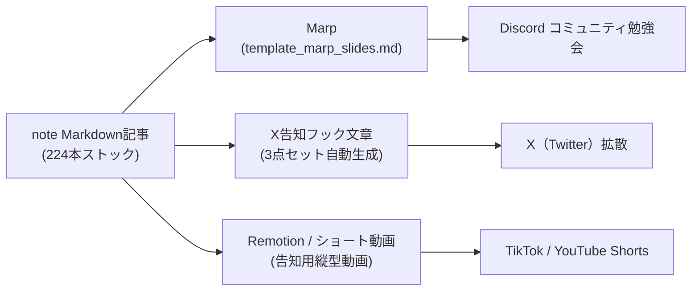

# 🎨 世界水準デザインリソース ＆ メディア自動化ツールボックス (Design & Media Toolbox)

本ドキュメントは、Sovereign OS（04_PORTAL, 05_PILOT, note告知, コミュニティ資料）の品質を世界最高峰水準へ引き上げ、コンテンツ制作を自動化するための**厳選ツール・OSS・デザインリファレンス集（SSoT）**です。

---

## 🌟 1. Web/UI デザイン・インスピレーション集（@BardhylBytyqi 推薦）

ポータルの画面設計、note告知LP、バランサーのUI改善時に参照する最高峰ギャラリー。

| サービス名 / URL | 種別 | 特徴 ＆ Sovereign OS での活用法 |
| :--- | :--- | :--- |
| **[godly.website](https://godly.website)** | 受賞Webサイト集 | 世界中のWebデザインアワードを受賞した最高峰のサイト集。配色、タイポグラフィ、余白のプロ級バランスを参考にする。 |
| **[60fps.design](https://60fps.design)** | スマホUIアニメーション | 触っていて気持ちいいモバイルUIのマイクロインタラクション集。ガチャ演出やバランサーの確定アニメーションの参考。 |
| **[landdding.com](https://landdding.com)** | LPデザイン集 | コンバージョン率の高いLP（ランディングページ）集。noteマガジンの販売ページや大会告知ページのレイアウト見本。 |
| **[modulify.ai](https://modulify.ai)** | AI Web/UI生成 | 高品質なWebコンポーネントを即座に生成するAIデザインツール。 |
| **[motionin.design](https://motionin.design)** | 1プロンプトWeb生成 | 1つのプロンプトからWebサイト全体の動的デザインを出力するツール。 |
| **[wonderlist.design](https://wonderlist.design)** | Figmaデザイン集 | 127種類以上のFigmaコンポーネント・UIデザインライブラリ。 |
| **[iconly.design](https://iconly.design)** | 高品質アイコン素材 | 洗練されたベクターアイコンセット。Lucideと併用してUIの格調を高める。 |

---

## 🎬 2. メディア自動化・ドキュメント変換OSS（@noa_gpt, @e1genqq 推薦）

note記事のMarkdownから、スライドやショート動画を瞬時に自動生成するためのオープンソースツール群。

| ツール名 | カテゴリ | 概要 ＆ 連携方法 |
| :--- | :--- | :--- |
| **[Marp](https://marp.app)** | スライド自動生成 | Markdownテキストに `---` を挟むだけで、勉強会用スライド（PDF/HTML）を1秒で出力する神ツール。テンプレート：[`01_INTEL/template_marp_slides.md`](file:///d:/my_work/01_INTEL/template_marp_slides.md) |
| **[Remotion](https://www.remotion.dev)** | React動画自動生成 | 動画編集ソフトを使わず、React/TypeScriptコードからアニメーション付きショート動画（縦型動画）を自動レンダリング。 |
| **[MarkItDown](https://github.com/microsoft/markitdown)** | Microsoft公式変換 | PDF, Word, Excel, PowerPoint を LLMが最も理解しやすいクリーンなMarkdownへ瞬時に変換するPythonツール。 |
| **[Firecrawl](https://www.firecrawl.dev)** | Webサイト丸ごとMD化 | Webページやドキュメントサイト全体をクローラーで巡回し、クリーンなMarkdownとして一括抽出するツール。 |
| **[Crawl4AI](https://github.com/unclecode/crawl4ai)** | 非同期高速クローラー | LLMフレンドリーな高速オープンソースWebクローラー。パッチノートやメタサイトの収集に最適。 |

---

## 📊 3. エージェント管理・可視化ボード（@0ooooo0 推薦）

複数エージェントの並列稼働状況や、バックグラウンドタスクの進行を直感的に把握するためのUI設計論。

| プロジェクト | 特徴 | Sovereign OS での活用 |
| :--- | :--- | :--- |
| **Jotloom** | 大学の時間割・カンバンUI | 計画書やGitHub PRのステータスを読み取り、エージェントのタスク進行をタイムラインで描画。人間が判断すべき作業だけを「要確認」に集約。 |
| **artiboard** | Claudeエージェント管理ボード | 複数エージェントの並列タスクとトークン消費をチーム共有・最適化するダッシュボード。 |

---

## 💡 活用フロー

