# 🌐 システム全体依存関係マップ ＆ ナレッジグラフ (System Dependency Graph)

本ドキュメントは、Sovereign OS（04_PORTAL, 05_PILOT, Discord KTM Bot, 常駐デーモン, Supabase DB）における**UI画面、API、データベーステーブル、外部サービス（Discord/WebPush/Cron）の相互依存関係**を可視化した単一の真実（SSoT）です。

「このファイルを変更した際、どこに影響が波及するか」「このテーブルのカラムを変更した時、どの画面とAPIが壊れるか」を即座に逆引きできます。

---

## 🗺️ 全体アーキテクチャ鳥瞰図

```mermaid
flowchart TD
    subgraph Client ["🖥️ Web UI (04_PORTAL / 05_PILOT)"]
        UI_Balancer["/balancer<br/>チーム分け・参加者管理"]
        UI_Record["/balancer/record<br/>試合結果記録・最終戦"]
        UI_Bet["/bet<br/>勝敗予想・オッズ"]
        UI_Shop["/shop<br/>コイン交換所・ガチャ"]
        UI_History["/history<br/>対戦履歴・戦績"]
        UI_Pilot["05_PILOT<br/>AIコーチ・辞典・ライブラリ"]
    end

    subgraph API ["⚡ API & ビジネスロジック (04_PORTAL)"]
        API_Record["/api/match/record<br/>(matchRecord/* 分割モジュール)"]
        API_Bet["/api/bet/*<br/>予想作成・購入・返金"]
        API_Shop["/api/shop/*<br/>購入・ガチャ・台帳"]
        API_Discord["/api/discord/*<br/>VCステータス・募集"]
        API_Cron["/api/cron/*<br/>定期バッチ・オンボーディング"]
    end

    subgraph DB ["🗄️ Supabase PostgreSQL"]
        T_Users["ktm_users<br/>(ユーザー基本・コイン・MMR)"]
        T_Matches["ktm_matches<br/>(試合結果・チーム構成・match_type)"]
        T_Coins["ktm_coin_transactions<br/>(コイン増減台帳・受取印)"]
        T_Bets["ktm_bets / ktm_bet_participants<br/>(勝敗予想・賭け金)"]
        T_Settings["ktm_settings<br/>(システム設定・VC情報)"]
        T_Lottery["ktm_lottery_pool<br/>(ジャックポット宝くじ)"]
    end

    subgraph External ["📡 外部連携・バックグラウンド"]
        Ext_Discord["Discord Bot & Webhook<br/>(通知・VCステータス・募集)"]
        Ext_Push["Web Push (VAPID)<br/>(試合開始・精算プッシュ)"]
        Ext_GHA["GitHub Actions<br/>(週次Cron・日次オンボーディング)"]
        Ext_CF["Cloudflare Workers<br/>(定期カスタム自動募集)"]
    end

    %% UI to API
    UI_Balancer --> API_Discord
    UI_Record --> API_Record
    UI_Bet --> API_Bet
    UI_Shop --> API_Shop

    %% API to DB
    API_Record --> T_Matches
    API_Record --> T_Users
    API_Record --> T_Coins
    API_Record --> T_Bets
    API_Record --> T_Lottery
    API_Bet --> T_Bets
    API_Bet --> T_Coins
    API_Shop --> T_Coins
    API_Shop --> T_Users

    %% API to External
    API_Record --> Ext_Discord
    API_Record --> Ext_Push
    API_Discord --> Ext_Discord
    Ext_GHA --> API_Cron
    Ext_CF --> API_Discord
```

---

## 📊 7大コア機能の双方向依存マトリクス

### 1. チーム分け ＆ バランサー (`/balancer`)
| 構成要素 | パス / テーブル | 役割・依存内容 |
| :--- | :--- | :--- |
| **画面 UI** | `04_PORTAL/src/app/balancer/page.tsx` | 参加者名簿の管理、MMR格差診断、卓分割、チーム分け実行 |
| **部品 Hook** | `src/app/balancer/_parts/*` | `usePlayerRoster`, `useBalancerAdminStats`, `useResultSwap` 等 |
| **計算ライブラリ** | `src/lib/balancer/diagnosis.ts`, `teams.ts` | 格差診断（GAP_THRESHOLD=250）、レーン別MMR最適化アルゴリズム |
| **依存 API** | `/api/discord/custom-voice-channel-status` | VC名・募集状態の更新（インターバル・試合中） |
| **参照 DB** | `ktm_players`, `ktm_settings` | プレイヤーMMR、レーン希望、管理設定 |
| **連携外部** | Discord KTM Bot | VCステータス更新、チーム分け結果Discord通知 |

### 2. 試合結果記録 ＆ コイン精算 (`/balancer/record`)
| 構成要素 | パス / テーブル | 役割・依存内容 |
| :--- | :--- | :--- |
| **画面 UI** | `04_PORTAL/src/app/balancer/record/page.tsx` | 試合結果（勝敗・キル数・MVP・最終戦チェック）の入力 |
| **中核 API** | `04_PORTAL/src/app/api/match/record/route.ts` | 試合記録オーケストレーター（260行） |
| **分割モジュール** | `src/lib/matchRecord/validator.ts` | 入力バリデーション（空文字・10人構成・重複チェック） |
| | `src/lib/matchRecord/calculator.ts` | MMR増減計算、コイン付与額計算、全損保険・JP判定 |
| | `src/lib/matchRecord/settlement.ts` | DB永続化（`ktm_matches`, `ktm_coin_transactions`） |
| | `src/lib/matchRecord/notifier.ts` | Discord Webhook通知、VCステータスクリア、Web Push |
| **参照・更新 DB** | `ktm_matches` | 試合スコア・勝敗・参加者・MVP・match_type |
| | `ktm_users` | MMR更新、総コイン保有数更新、連勝/連敗記録 |
| | `ktm_coin_transactions` | 勝利報酬・MVP・参加賞・予想配当の台帳記録 |
| | `ktm_bets` / `ktm_bet_participants` | 予想締め切り・的中者への配当金自動送金 |
| | `ktm_lottery_pool` | ジャックポット当選判定・プール金リセット |
| **連携外部** | Discord Webhook | `#試合結果` へのリッチ埋め込み通知、VCステータス自動消去 |
| | Web Push | 全登録端末への試合終了プッシュ通知 |

### 3. 勝敗予想 ＆ オッズベッティング (`/bet`)
| 構成要素 | パス / テーブル | 役割・依存内容 |
| :--- | :--- | :--- |
| **画面 UI** | `04_PORTAL/src/app/bet/page.tsx` | 試合前のブルー/レッド勝敗予想、オッズ表示、賭け金入力 |
| **依存 API** | `/api/bet`, `/api/bet/place` | 予想受付（試合開始で自動ロック）、重複投票防止 |
| **参照・更新 DB** | `ktm_bets` | 募集中の予想案件、締め切りフラグ |
| | `ktm_bet_participants` | 各ユーザーの賭け先チーム・賭け枚数 |
| | `ktm_coin_transactions` | ベット時の即時コイン引き落とし（`bet_placed`） |

### 4. コイン交換所 ＆ ガチャ (`/shop`)
| 構成要素 | パス / テーブル | 役割・依存内容 |
| :--- | :--- | :--- |
| **画面 UI** | `04_PORTAL/src/app/shop/page.tsx` | ショップアイテム一覧、ロール権限・限定称号購入、ガチャ演出 |
| **依存 API** | `/api/shop/buy`, `/api/shop/gacha` | 残高確認、在庫管理、アイテム付与、ガチャ確率抽選 |
| **参照・更新 DB** | `ktm_shop_items` | アイテムマスター（価格・在庫・有効期限） |
| | `ktm_inventory` | ユーザーの所持アイテム・称号 |
| | `ktm_coin_transactions` | コイン消費履歴（`shop_purchase`, `gacha_spin`） |
| **連携外部** | Discord Bot | 購入時のロール自動付与、称号付与通知 |

### 5. 定期募集 ＆ オンボーディング (Automation)
| 構成要素 | パス / テーブル | 役割・依存内容 |
| :--- | :--- | :--- |
| **定期募集** | Cloudflare Workers Cron ➔ KTM Bot | 毎週月・木の定期募集ポストをDiscordチャンネルへ自動送信 |
| **オンボーディング** | GitHub Actions (`portal-weekly-crons.yml`) | 毎晩20:00 JSTに新メンバーへ歓迎DM・メンター通知を実行 |
| **依存 API** | `/api/cron/onboarding` | オンボーディングバッチ（Vercel CPU消費ゼロ・GitHub Actions移設済） |
| **参照・更新 DB** | `onboarding_channel_state` | 案内送信履歴、ナッジ送信タイムスタンプ |
| | `ktm_settings` | 指定メンターリスト（`onboarding_mentors`） |

### 6. 名簿・プレイヤーカルテ ＆ 履歴 (`/members`, `/history`)
| 構成要素 | パス / テーブル | 役割・依存内容 |
| :--- | :--- | :--- |
| **画面 UI** | `04_PORTAL/src/app/members/page.tsx`, `/history/page.tsx` | メンバー一覧、レーティング推移、過去試合の詳細スタッツ |
| **依存 API** | `/api/members`, `/api/match/history` | ユーザー統計、勝率・ロール別実績の取得 |
| **参照 DB** | `ktm_users`, `ktm_matches` | レーティング、通算成績、MVP回数、マッチ詳細 |

### 7. ソロQ戦術AIコーチ ＆ 攻略辞典 (05_PILOT)
| 構成要素 | パス / テーブル | 役割・依存内容 |
| :--- | :--- | :--- |
| **画面 UI** | `05_PILOT/src/app/coach/page.tsx`, `/library/page.tsx` | チャンピオン別攻略、タイムライン逆再生、Habit Radar |
| **連携デーモン** | KTM Match Watcher (Python) | LCU API から試合後スタッツ（CS/分、デスタイムライン）を自動抽出 |
| **AI エンジン** | Gemini 3 Flash / Pro | YouTube動画解説からタイムスタンプ付き戦術知見を自動抽出・推敲 |
| **参照 DB** | Supabase `knowledge_revisions`, `matchup_sentinel` | 攻略知見マスター、対面対策メモ、訂正辞書 |

---

## 🔍 逆引きインパクトチェッカー（「ここを直したらどこを見るか」）

### ケース1: `ktm_matches` テーブルのカラムを変更・追加する場合
- [ ] `04_PORTAL/src/lib/matchRecord/settlement.ts`: INSERT文のペイロード修正
- [ ] `04_PORTAL/src/app/api/match/history/route.ts`: 履歴取得SELECTのプロパティ修正
- [ ] `04_PORTAL/src/app/history/page.tsx`: 履歴表示UIの反映
- [ ] `04_PORTAL/src/app/balancer/record/page.tsx`: 入力フォームへのフィールド追加

### ケース2: コインの増減理由（`CoinReason`）を追加・改変する場合
- [ ] `04_PORTAL/src/lib/coinLedger.ts`: `CoinReason` Union型の定義更新
- [ ] `04_PORTAL/src/lib/matchRecord/settlement.ts`: 精算時の理由指定
- [ ] `04_PORTAL/src/app/shop/page.tsx`: ショップ取引履歴の日本語表示ラベル

### ケース3: Discord Webhook や通知フォーマットを変更する場合
- [ ] `04_PORTAL/src/lib/matchRecord/notifier.ts`: 試合結果埋め込み（Embeds）の生成ロジック
- [ ] `04_PORTAL/src/app/api/discord/custom-voice-channel-status/route.ts`: VCステータス更新
- [ ] 環境変数 `MATCH_RECORD_WEBHOOK_URL` / `DISCORD_BOT_TOKEN` の疎通確認

### ケース4: Vercel / GitHub Actions のスケジュールを変更する場合
- [ ] `.github/workflows/portal-weekly-crons.yml`: Cronスケジュール・シークレット設定
- [ ] `04_PORTAL/vercel.json`: **`crons: []` のまま維持**（Vercel側で定期実行を復活させない）
