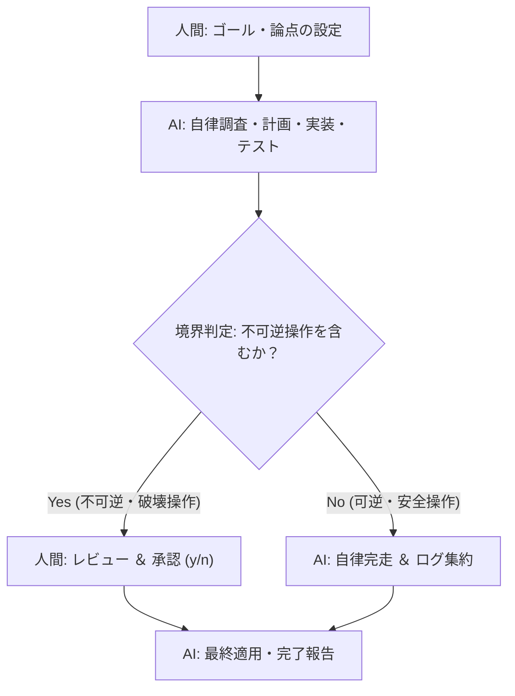

# 🤖 自立型AIエージェント協働 ＆ ゴール委任プロトコル (Autonomous Delegation Protocol)

本ドキュメントは、「指示待ち・対話型の生成AI」から「目標を与えて放置できる自立型デジタル同僚（Autonomous Co-worker）」へのパラダイムシフトを踏まえ、AIエージェントへの業務委任・非同期自律稼働・人間との境界設計（Human-in-the-Loop）を規定する行動規範です。

---

## 🔗 一次情報源（インプット出典）
- **記事**: [「質問するAI」から「任せるAI」へ。24時間自律稼働時代に私たちが変えるべき仕事の習慣](https://note.com/legal_macaw1541/n/n69cf06586efe)（著者: mk_pr_12氏, 2026-10-07）

---

## 🏛️ 第1章：協働思想の転換（Paradigm Shift）

### 1.1 手順指示（Micro-management）からゴール設定（Goal-oriented）へ
- **旧来の指示（対話型）**: 「〇〇のファイルを検索して、△△行目をこのように書き換えて」
- **自立型の指示（ゴール型）**: 「〇〇の不具合を解消し、テストと型チェックを通過させ、変更内容の検証ログをまとめておいて」
- AIは内部で思考の連鎖（Chain-of-Thought / Think Mode）と試行錯誤（自己修正）を回し、自律的にツールを駆使してゴールへ到達する。

### 1.2 評価軸の転換：手作業の時間から「成果物の確認」へ
- 人間の価値は「手を動かしてコードを書くこと」ではなく、「AIが導き出した成果物を素早くレビューし、合否の意思決定を下すこと」へ移行する。

---

## 🛡️ 第2章：境界設計（Human-in-the-Loop ＆ 安全防壁）

AIにどこまで自律的に任せ、どこで人間の承認を必須とするかの境界線（バウンダリ）を厳格に定義する。



### 2.1 AIに委任する領域（自律実行・放置OK）
1. コードベースの横断調査（grep、ファイル閲覧、依存関係解析）
2. 修正コードのドラフト作成・部品化・リファクタリング
3. ローカルビルド、TypeScript型チェック、ユニットテストの実行と自己修復
4. ログ集約、ドキュメント生成、要約レポート作成

### 2.2 人間の承認を必須とする領域（不可逆・要承認）
1. 本番データベースへの変更適用（Migration、データ削除・更新）
2. 外部本番デプロイ（Vercel本番公開、Cloudflare Workerデプロイ等）
3. ファイルの完全削除（`rm`）やGitの破壊的変更（強制プッシュ等）
4. 外部API経由でのユーザー通知（Discord一斉アナウンス等）

---

## 📋 第3章：退勤前・離席前の「放置タスク」運用標準

一日の終わりや離席時に、AIエージェントへタスクを預けて画面を閉じる際の制式フォーマット。

```markdown
### 🎯 [放置タスク名]
- **ゴール（期待する完了状態）**: 
  - 例: 「〇〇APIのレスポンス速度を改善し、ビルドエラー0件でコミット可能な状態にする」
- **制約・境界条件**:
  - 例: 「既存のDBスキーマは変更しない」「外部通知は送信しない」
- **自律テスト条件**:
  - 例: 「npm run build が PASS すること」「実値ログを採取すること」
- **成果物の報告形式**:
  - 変更ファイル一覧、機械的検証ログ、次回判断を仰ぐポイント（3行要約）
```

---

## 🔄 第4章：日常の3大AI協働ルーティン

1. **ルーティン①：退勤前・離席前の「放置タスク」設定**
   - 作業終了時に翌朝までに進めておきたいリサーチやコードチェックをエージェントに預ける。
2. **ルーティン②：「承認者（レビュアー）」視点での精査**
   - AIの成果物を盲信せず、「機械的実値ログ（Verifier）」と差分をレビューして承認する。
3. **ルーティン③：週末の「手作業ログ」見直し**
   - 1週間で人間が行った手作業を振り返り、「スクリプト化またはAIエージェントへ委任できるタスク」を特定して自動化へ移管する。

---

## 🎯 思考トリガー（実戦への問いかけ）

> 「いま自分が手を動かしているその作業は、『手順の指示』ではなく『明確なゴールと検証基準を与えてAIに放置させること』ができないだろうか？」
