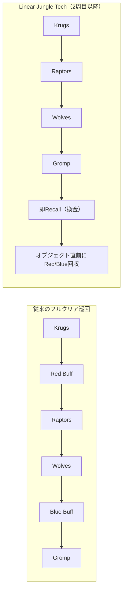

# ⚡ Linear Jungle Tech（4キャンプ同期循環と先行リコール）

> **一次情報源 (出典)**:  
> - 著者: raaaaaq氏  
> - 提唱者: Tarzaned (海外チャレンジャーJGストリーマー)  
> - 記事URL: [【LoL】新JGルート？ Linear Jungle techについて。](https://note.com/raq/n/n43e038f3f017)  
> - コミュニティ検証: Reddit r/Jungle_Mains ("What exactly is Tarzaned's new 'linear clear' and when is it actually good?")

---

## 🎯 1. Linear Jungle Tech の骨子と基本思想

### 定義
> **"JGクリア途中にリスポーンするBuff（Red/Blue）をあえてSkipし、通常4キャンプ（Krugs / Raptors / Wolves / Gromp）を優先循環させることで、通常キャンプのリスポーン時間を同期させ、先行リコールによる戦闘力換金と、オブジェクト直前でのバフ効果時間最大化を狙う戦術"**

---

## 💎 2. 従来のフルクリアに対する3大メリット

### ① 通常キャンプのRespawn（再湧き）タイミングの完全同期
- 従来の巡回では、赤バフ・青バフの狩り速度や移動距離によって、キャンプごとの再湧き時間がバラバラになりやすい。
- Krugs ➔ Raptors ➔ Wolves ➔ Gromp と直線的（Linear）に4通常キャンプだけを繋ぐことで、**次周のキャンプがほぼ一斉に整列して湧く**ようになり、クリア動線上のタイムロス（空白時間）が根絶される。

### ② 先行リコールによる「未換金Goldの即座な戦闘力化」
- 6キャンプ全てを回り切ろうとすると、所持Goldが1,000〜1,400Gに達したままマップを徘徊することになる。
- 4キャンプを狩り終えた時点で素早くRecallを挟むことで、**ロングソードやツルハシ、ブーツ等の実質スタッツに即座に換金**できる。
- 「大量のGoldをポケットに入れたままドラゴン前で敵と交戦し、アイテム差で負ける」という典型的な事故を未然に防ぐ。

### ③ オブジェクト戦・集団戦直前での「バフ効果時間最大化」
- 通常巡回の中でRed/Blueを狩ってしまうと、ファーム中にバフの有効時間が2分近く無駄に消費されてしまう。
- リコール後、あるいはオブジェクト（ドラゴン/ヘラルド）の湧き時間（30秒〜45秒前）に合わせて赤バフ/青バフを回収して合流することで、**戦闘開始時に100%フルのバフ持続時間を持ち込める**。

---

## ⚠️ 3. デメリットと破綻条件（リスク管理）

| リスク要因 | 危険なシチュエーション | 対策・回避基準 |
| :--- | :--- | :--- |
| **敵JGによるバフ強奪** | グレイブス、キンドレッド、ニダリー、シヴァーナ、リリアなど高速インベードが得意な相手 | 敵JGの位置が完全に特定できていない時は無理にSkipしない |
| **レーン主導権の欠如** | 隣接レーン（Bot/Mid/Top）が押し込まれており寄れない状態 | 味方レーナーがカバーできない時間帯はバフを放置しない |
| **バフの腐敗** | 相手に取られずとも、長時間の放置で経験値テンポを失う | 「暇な時間」「オブジェクト前の通過動線」で確実に回収する |

> 📌 **判断の結論**:  
> 毎試合機械的に固定で行うものではない。**「対面JGのインベード圧力が低い」「味方レーンがプッシュ主導権を持っている」**というGame Stateが確認された場合に発動する高効率オプションである。

---

## 🧠 思考トリガー（実戦への問いかけ）

> **実戦シチュエーション**:  
> あなたは6分30秒時点で自陣ボットサイドのKrugsとRaptorsを狩り終え、手持ちGoldが950Gある。ドラゴン出現まで残り1分15秒。敵JGはアムム（インベード能力低）。あなたはWolvesへ向かうか、リコールしてセレーション・ダーク（脅威素材）を買ってから赤バフへ向かうか？
