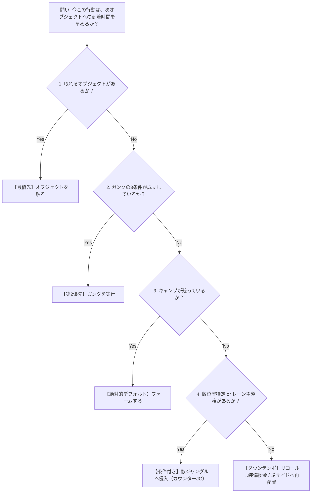

# 🌲 JG意思決定ツリー ＆ ダウンテンポ哲学

> **一次情報源 (出典)**:  
> - 著者: 天狐ハク氏（KRチャレンジャー 1000LP監修 / LoL体系化）  
> - 記事URL: [【ジャングルのすべて ep.1】 ダウンテンポを勘違いするな。時間を捨てる三流と期待値を操るチャレンジャー](https://note.com/haku_lolbible/n/nba27e9b5c351)

---

## 🧭 1. JGの本質：レーンはなく「時間」しかない

ジャングルには、他レーンのような固定されたミニオンウェーブやタワーの境界線が存在しない。ジャングラーが持っている唯一のリソースは**「時間」**である。

ティアが分かれる分岐点は、「どこをガンクするか」「ドラゴンを触るか」という答えそのものではない。  
**その問いを「感覚」で解いているか、「期待値」で解いているか**にある。

---

## ⏳ 2. ダウンテンポの真髄：暇な時間ではなく「リソースの再整列」

### 誤った解釈 vs チャレンジャーの定義
- **三流の誤解**: ダウンテンポ＝「やることがない失敗した暇な時間」「待機時間」。
- **チャレンジャーの定義**: **今すぐキルを作れない状況下において、次の選択の質を上げるために、自らのリソース（体力・スマイト・視界情報）とポジションを再び整列させる区間**。

### テンポとは「選択肢」の数
- テンポとは移動速度（MS）ではない。**「今取れる有効な選択肢の数」**である。
- ガンクに失敗して体力が半分、スマイトもなく、レーンも押し込まれている状況で「もう一度突っ込んでフラッシュを落とさせよう」とする行為は、**ダウンテンポを完全に破壊しテンポをドブに捨てる自殺行為**である。
- ガンク失敗から即座に引き返し、残りのキャンプを食い、敵JGの位置を再計算して次のオブジェクトが湧く方向へ動線を組み直す行為こそが「ダウンテンポを正しく使った瞬間」である。

---

## 🌳 3. ジャングルの4択優先順位ツリー

ジャングラーに許可された行動は常に以下の**4つのみ**である。これを目についた順に選ぶのをやめ、15秒に1回以下のデフォルト順序で自分に問いかける。

### 優先順位のデフォルト値
1. **オブジェクト（最優先）**: 取れる条件（レーン主導権、敵JGの逆サイド露呈など）があれば最優先で触る。マップ状況を恒久的に変えるため。
2. **ガンク（第2優先）**: 後述する「3条件」が同時に成立している場合のみ実行。
3. **ファーム（絶対的なデフォルト値）**: オブジェクトもガンク条件も揃っていなければ、ファームが唯一の正解。次の選択の資本（Gold/XP）となる。
4. **敵ジャングル侵入（条件付き）**: 敵JGの位置が確実に判明しているか、隣接レーンの主導権を握っている時のみ許可される。

---

## 🚫 4. ガンクの3大成立条件（1つでも欠ければ自殺）

ガンクは能動的な目標ではなく、以下の**3条件が揃った結果として転がり込んでくる「副産物」**に過ぎない。

| 条件 | チェック項目 | 不成立時のリスク |
| :--- | :--- | :--- |
| **① 敵ライナーの位置** | 川より前に出ているか？ 体力/マナが削れているか？ 生存スキル/Flashがないか？ | 深追いして逃げられ、時間と体力を浪費する |
| **② 味方ライナーの状態** | 追従できる体力・マナがあるか？ CCや移動スキルが残っているか？ | 2v1の形を作れず、返り討ち（逆キル）に遭う |
| **③ 自身の到着状況** | 敵の視界に映らずに裏を取れるか？ 敵JGのカウンターガンクがないか？ | カウンターガンクを受け、2v2で壊滅する |

> ⚠️ **格言**:  
> この3つのうち1つでも欠けている状態で突っ込む場面を、ゴールドのジャングラーは「ガンクを試みた」と記録し、チャレンジャーは「テンポを自ら破壊した」と記録する。

---

## 🗺️ 5. トラッキングの本質と「等価交換（トレード）」

### 敵を探すな、「到着時刻」を予約せよ
- トラッキングとは「今どこに隠れているか」を探すことではない。**「いつどこに現れるか（最小到着ウィンドウ）」をスケジュールとして計算すること**である。
- 最初のリーシュ位置（ボット側かトップ側か）、3キャンプ型かフルクリア型かによって、敵JGがレーンに顔を出せる最速時間は決まっている。

### 見ているだけなら情報は飾り（等価交換の原則）
- 敵JGがトップレーンに姿を現した瞬間：
  - ボット側のキャンプを強奪する
  - ボットダイブを通す
  - ドラゴンのセットアップを組む
- **敵の姿を確認しておきながら、反対側で何もリソースを回収しないなら、その視界情報は単なる飾りである。** チャレンジャーは「敵が映る前に、映った瞬間に何を奪うか」をあらかじめ決定して動いている。

---

## 🧠 思考トリガー（実戦への問いかけ）

> **実戦シチュエーション**:  
> 試合開始3分20秒、敵JGがボットレーンへガンクを仕掛けて味方ADCがデスした。この瞬間、トップ側にいるあなた（自陣赤バフ側）の画面と手元はどう動くべきか？（※「味方ボットが溶けた…」とチャットを打つのは最悪のテンポ破壊である）
