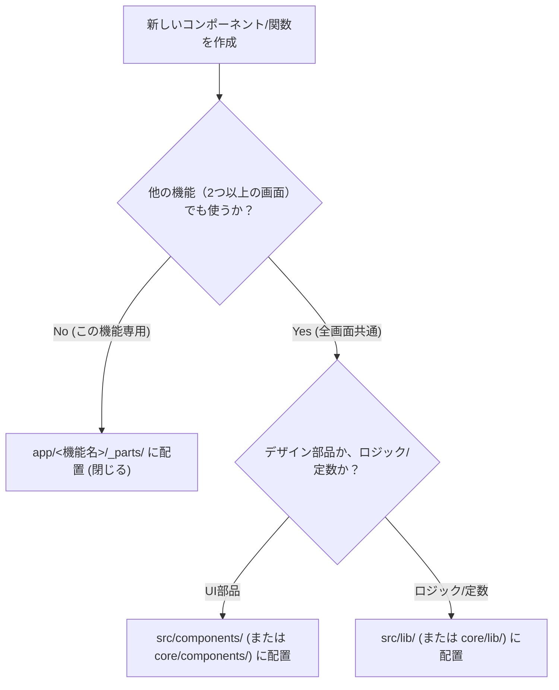

# 📁 機能別フォルダ構成 ＆ 自己完結アーキテクチャ規約 (Feature-Driven Architecture)

本ドキュメントは、あすらぼ氏の提唱する「アプリ個人開発で最初からやっておくべき神7設計：機能別フォルダ構成（Feature-Driven Architecture）」思想に基づき、Sovereign OS（Next.js App Router / TypeScript）におけるファイル配置・責務分離・モジュール境界を規定する**最上位アーキテクチャ規約**です。

---

## 🔗 一次情報源（インプット出典）
- **記事**: [アプリ個人開発で「最初からやっておけばよかった」設計7選](https://note.com/aslab/n/nb63993e63452)（著者: あすらぼ氏, 2026-10-10）

---

## 🏛️ 第1章：設計思想 ── 「教科別お道具箱」の原則

### 1.1 水平レイヤー分割（Layered）の破綻
- **旧来の構成**: `components/`, `models/`, `utils/`, `screens/`
- **問題点**: アプリが5画面、10画面と成長した瞬間、「バランサーを直すために 5 つのフォルダを行き来する」ファイル迷子が発生する。不要になった機能を削除するときも、関連ファイルが散乱してゴミ（デッドコード）が残り続ける。

### 1.2 機能別自己完結化（Feature-Driven）
- **新原則**: 機能（Feature / Domain）ごとに1つの箱（フォルダ）を作り、その機能に必要な**画面・部品・フック・型・計算関数を1箇所に閉じる（カプセル化）**。
- **効果**:
  1. ファイル探索時間がゼロになる（そのフォルダを開けば全て揃っている）。
  2. 機能の追加・修正・削除がフォルダ単位で安全に完結する。
  3. UIとロジックの結合度が下がり、単体テストが書きやすくなる。

---

## 📁 第2章：Next.js App Router 制式フォルダ規約

Next.js App Router のルーティング特性を活かし、以下の3層で構造化する。

```text
src/
├── core/ (または shared/)          ➔ 全機能で使い回す真の共通層
│    ├── components/               ➔ 汎用ボタン、モーダル基盤、NavBar等
│    ├── constants/                ➔ 全社定数・用語集 (VOCABULARY)
│    └── lib/                      ➔ Supabaseクライアント等（統一ロガー logger.ts は未使用のため 2026-10-16 に削除）
│
└── app/
     ├── <機能ルート名>/ (例: balancer, lane-guides, coach)
     │    ├── _parts/ (機能の箱)   ➔ その機能専用の完全閉鎖お道具箱（URL非公開）
     │    │    ├── components/    ➔ その機能専用のUI部品
     │    │    ├── useFeature.ts  ➔ その機能専用のカスタムフック（データ通信・状態管理）
     │    │    ├── types.ts       ➔ その機能専用の型定義
     │    │    └── logic.ts       ➔ その機能専用の純粋計算関数（単体テスト対象）
     │    │
     │    ├── api/                ➔ その機能専用のAPIルートハンドラ
     │    └── page.tsx            ➔ 画面（お道具箱から部品を組み立てるだけ）
```

---

## 🛡️ 第3章：ファイル配置の判定フローチャート

新しいファイルを作成する際は、以下のフローで配置先を機械的に決定する。



---

## 🎯 思考トリガー（実戦への問いかけ）

> 「いま作成したそのモーダルやフックは、本当に全画面で使い回す共通部品か？ 特定の機能フォルダ（_parts）の中に閉じるべきではないか？」
