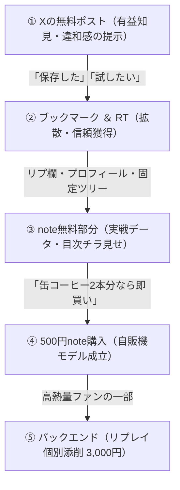

# 🎯 500円note自販機直結：X（Twitter）無料集客ポスト運用フレームワーク

本ドキュメントは、LoL実戦教本・脱出マクロ（500円note）を自動販売機のようにチャリンチャリンと継続購入させるための、X（Twitter）フロントエンド集客ポストの設計書および実戦テンプレート集です。

---

## 🏛️ 集客ファネルの基本構造



---

## 📐 爆発力を生む「4層ポスト構造」

1行目でスクロールの手を止めさせ、最後の1行で自然にnote自販機へ誘導する4ステップ。

1. **【Hook（違和感・常識の破壊）】**:
   - 多くのプレイヤーが信じ込んでいる「間違った常識」や「言語化できていないモヤモヤ」を突く。
   - ❌ 悪い例: 「ガレンの立ち回り解説します！」（見向きもされない）
   - ⭕ 良い例: 「『対面がロームしたらタワーを殴れ』を愚直にやってデスしてるTOPの9割は、このマップの〇〇秒を見てない。」
2. **【Data（客観的事実・実測秒数）】**:
   - 感想や精神論を排除し、動画解析・タイムラインから得た**客観的な数字**を提示する。
   - 例: 「フルクリアJGがリフトスカトルに到達するのは最短3分18秒。リバー草むらのワードは3分05秒に置かないと看破できない。」
3. **【Reason（なぜ勝てるかの構造・理屈）】**:
   - 「なぜその行動が必要なのか」を言語化し、読者に「なるほど！」という納得感（ドーパミン）を与える。
4. **【Exit / Trigger（思考の呼び水 ＆ note誘導）】**:
   - 実戦を想起させるシチュエーションを投げかけ、詳細はリプ欄のnoteへ流す。
   - 例: 「相手がLv3でBotに見えた瞬間、あなたはタワー下ウェーブを引くか押し切るか？ 全対面20チャンプ別のリコール秒数リストはリプ欄にまとめました（缶コーヒー2本分）。」

---

## 📝 実戦テンプレート集（コピペ＆微調整用）

### テンプレート1：【対面マッチアップ・キルゾーン特化型】
```text
【対面〇〇で勝率4割切ってる人が見落としてる「最初の2分」の真実】

〇〇相手にLv2先行されて体力半分削られてる人は、初手ウェーブの殴り方が逆です。

多くの解説は「引いて耐えろ」と言いますが、実戦データでは【1ウェーブ目の後衛ミニオンを〇発殴ってLv2先行阻止】しないと、3ウェーブ目のクラッシュダイブが確定します。

・初手間合い：通常攻撃〇〇レンジ維持
・キルゾーン発生時刻：〇分〇〇秒
・パワースパイク：〇〇完成時

これだけで序盤の事故死がゼロになります。

対面20チャンプ別の「スキル温存秒数」と「リコール判断表」はリプ欄のnoteにまとめました（500円）。今日のリフトから即使えます👇
```

### テンプレート2：【JGルート・定石タイマー特化型】
```text
敵JGにガンクされて「JG差」って打ってる人、これだけ覚えてください。

現パッチでフルクリアJGがリバーに顔を出すのは【最短〇分〇〇秒】です。

・〇分〇〇秒：自陣側リバー草むらへ初手ワード
・〇分〇〇秒：相手JGのファーム終了（Bot側かTop側か判明）
・〇分〇〇秒：最初のガンク警戒ピーク

「マップをずっと見る」のは不可能でも、「この3つの時計」を見るだけならゴールド・プラチナ帯でも一瞬でガンク回避率が80%上がります。

ロール別の初手視界ルートと、敵JGの逆算タイムテーブル完全版はリプ欄のnote自販機へ👇
```

### テンプレート3：【ランク脱出・思考トリガー型】
```text
シルバー・ゴールドを最短で抜ける人は「神プレイ」をしてるんじゃなくて、
「やってはいけないミス」を3つだけ削っています。

1. オブジェクト1分前にリコールしない（寄りが10秒遅れて壊滅）
2. 敵MIDの位置が見えないのにサイドレーンの2本目タワーを殴る
3. 初手アイテムで〇〇を積まずに火力に走る

「相手JGがBotに姿を見せた瞬間、あなたは対面をフリーズさせるか、ヘラルドを触るか？」
このシチュエーション判断の正解基準をnoteに書き殴りました。

缶コーヒー2本分（500円）でランクが1ティア上がる脱出マクロ集👇
```

---

## 🛡️ AI臭さ排除 ＆ 信頼担保チェックリスト

投稿前に以下を必ず確認すること：
- [ ] 「いかがでしたでしょうか」「ぜひ参考にしてください！」などの**AI特有の社交辞令・淡白な締めくくりが入っていないか**。
- [ ] 「必ず勝てる！」「絶対儲かる！」などの**安易な誇大広告になっていないか**。
- [ ] **具体的な数字（〇分〇秒、スキル名、アイテム名）が最低2つ以上入っているか**。
- [ ] リプ欄のnoteリンクには「何が手に入るか（対面別リスト、タイムライン表等）」が明記されているか。
