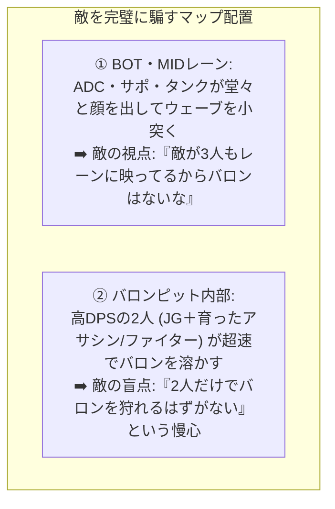

# LoL：全壊から大逆転する「ドラゴン10秒前バロン」の錯覚

味方のTOP、MID、BOTの全レーンが崩壊し、キルスコアも5-18の大差。
**「もうこの試合は降参（サレンダー）するしかない……」**

そう諦めかけた試合を、たった1つのマクロ判断で180度ひっくり返す必殺の戦術が存在します。
それが、天狐ハク氏が提唱する**「ドラゴン出現10秒前のバロン強襲（スニーク・錯覚マクロ）」**です。

なぜ全レーンで主導権がないのにバロンを狩り切れるのか？
相手チームの心理を逆手に取った「錯覚の作り方」を論理的に解説します。

---

## 1. 劣勢チームが直面する「ドラゴンの絶望」

試合が壊れている時、相手チームは次に何を狙うでしょうか？
100%の確率で**「ドラゴンの獲得（ソウルへの進行）」**です。

劣勢なチームがドラゴン周りに集まっても、視界がなく、装備差で集団戦に突入した瞬間に全滅（エース）を取られてゲームが即座に終わります。
かといって指をくわえてドラゴンを渡せば、相手にゴールドとソウルが渡り、窒息死するのを待つだけになります。

この「詰み」の盤面を打破する唯一の突破口が、**「相手全員がドラゴンに意識を奪われている隙に、真逆のバロンを狩り切る」**ことです。

---

## 2. 成功率を極限まで高める「錯覚の演出」

「バロンを触っても、敵に気づかれて止められるのでは？」と思うかもしれません。
チャレンジャー勢が仕掛けるバロン強襲は、相手に**「心理的錯覚」**を植え付けることで成立させています。

### タイムライン：ドラゴン湧く「10秒前」が絶対合図
1. **ドラゴン出現30秒前**:
   - 相手チーム全員が、ドラゴン川周辺の視界確保と陣地取りのためにマップ下部（Bot側）へ大移動を始めます。
2. **ドラゴン出現10秒前**:
   - 高DPSチャンピオン（グウェン、タロン、マスター・イー、アムム等）の2人が、ピンクワードで視界を消したバロンピットに入り、全スキルを吐いてバロンを強襲します。
   - 同時に、味方のADCやサポートは**「敵に見える位置（ミッドや自陣タワー前）」**でわざとウロウロしてミニオンを触ります。
3. **相手の心理**:
   - 「レーンに敵が見えている」「まさか2人だけでバロンなんて無理だろう」と油断し、相手は悠々とドラゴンを殴り始めます。
4. **ドラゴン出現直後**:
   - **「味方チームがバロンを倒しました！」**のアナウンスが響き渡ります。

相手がドラゴン1体を取っている間に、こちらは**バロンバフ＋1,500G＋全員の強化リコール**を手に入れ、一瞬で試合の形勢をイーブン（あるいは有利）へ引き戻すことができます。

---

## 3. この戦術を実行するための「2つの必須条件」

このスニークバロンは、どんな構成でもできるわけではありません。以下の2条件を満たしている時のみ発動してください。

1. **バロンの高速処理能力（DPS）があること**:
   - %割合ダメージを持つチャンプ（グウェン、ヴァルス、コグ＝マウ）や、高AS・高火力のチャンプが1〜2人ピット内にいること（20秒以内で狩り切れること）。
2. **バロンピット内に敵のワードが「1本もない」こと**:
   - コントロールワード（赤ピン）を必ずピット内に置き、敵の視界が完全にゼロであることを確認すること。

---

## 4. まとめ：絶望の試合をひっくり返す3箇条

1. **全壊した試合でドラゴンファイトに行くのは自殺行為。綺麗さっぱり捨てよ。**
2. **敵がドラゴンに殺到する「10秒前」に、高DPSチャンプがバロンを強襲する。**
3. **味方キャリーはあえてレーンに顔を出し、敵に「バロンはない」と錯覚させよ。**

不利な時こそ、相手が「セオリー通り」に動く瞬間が最大のスキになります。この錯覚マクロを武器に持っておけば、あなたの辞書から「逆転不可能な負け試合」が消え去ります。

---

> **💡 実戦への問いかけ（思考トリガー）**:
> 22分、スコアは大幅不利で相手がドラゴンソウルに王手をかけています。相手全員がBot川に集結したのがミニマップに映った瞬間、あなたは諦めてBot川に突撃しますか？ それとも味方にピンを打ってバロンピットへ直行しますか？
