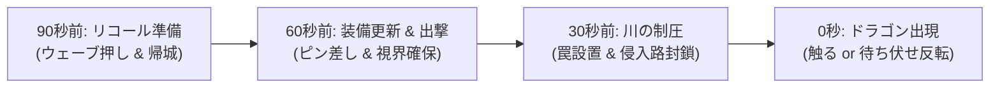

# LoL：ドラゴン戦の勝率が倍増する「90秒前リコール」の鉄則

ソロランクで味方に一番イライラする瞬間は何でしょうか？

おそらく**「ドラゴンが湧く瞬間に、なぜか味方JGやキャリーがリコールしている」**、あるいは**「視界が真っ暗なドラゴンピットに突っ込んで全員が各個撃破される」**シーンではないでしょうか。

断言します。
**ドラゴンファイトの勝敗は、ドラゴンが湧いた瞬間ではなく「湧く1分前」にすでに決まっています。**

どれだけ集団戦の操作（ミクロ）が上手くても、準備が遅れたチームは絶対に勝てません。今回は、マスター・チャレンジャー帯のプレイヤーが徹底している**「ドラゴン出現90秒前のタイムライン原則」**を完全公開します。

---

## 1. なぜ「湧いてから集まる」と100%負けるのか？

ドラゴンが湧く0秒時点で川に向かって歩いているチームは、すでに以下の3つの致命的ハンデを背負っています。

1. **アイテムとHP/マナの差（装備格差）**:
   先にリコールした敵は、1,500〜2,000ゴールド分の完成アイテムを買い、HP・マナが全快の状態で待ち構えています。リコールしていない味方は、素材止まりの低ステータスで戦わされます。
2. **視界の完全喪失（フェイスチェック死）**:
   先に川に入った敵は、コントロールワードでこちらの視界を消し、ブッシュの中に潜んでいます。遅れて川に入ろうとしたサポートやJGは、ブッシュから一斉にスキルを叩き込まれて瞬殺されます。
3. **ウェーブの損害（タワー削られ）**:
   ミッドやボットのミニオンを押し込まずにドラゴンに集まると、ファイト中に敵のミニオンが自陣タワーに突撃し、ファイトに勝ってもタワーを失う本末転倒な事態になります。

---

## 2. ドラゴン戦を制する「90秒タイムライン」

ドラゴン戦で100%の勝率を叩き出すための時計の読み方は、以下のステップに集約されます。

### 【90秒前】：ウェーブ押し切り ＆ リコール詠唱
- **行動**: レーンのウェーブを敵タワー下まで押し切り、その場で即リコールします。
- **理由**: リコールに8秒、買い出しに5秒、ベースから川まで歩くのに約25〜30秒かかります。合計で約45秒かかるため、90秒前にリコールボタンを押さなければ、川に万全な状態で到着できません。

### 【60秒前】：アイテム即買い ＆ 川へ急行
- **行動**: ベースを出撃し、サポートとJGはコントロールワード（ピンク）を1〜2本購入してドラゴン側へ向かいます。
- **ポイント**: 歩きながら「ドラゴンに集合」「川の視界を取る」のPingを鳴らし、味方の意識を統一します。

### 【30秒前】：川の視界奪取 ＆ 待ち伏せ（チョークポイント封鎖）
- **行動**: 赤レンズで敵のワードを消し、敵が入ってくる「狭い通路（ジャングル入口）」にワードを挿して視界を制圧します。
- **最重要セオリー**: **「ドラゴンを触ってはいけない」**。川のブッシュに全員で潜み、遅れて暗闇からやってくる敵の先頭（サポートやJG）を5人でキャッチして瞬殺します。

### 【0秒〜出現時】：数的優位での回収
- 敵を1人倒して5v4になった瞬間に、安全にドラゴンを狩り切るか、残りの敵を全滅させてゲームを決定づけます。

---

## 3. もし準備に遅れたらどうするべきか？（損切り判断）

ソロランクでは、味方が90秒前にリコールしてくれず、ドラゴン湧く30秒前時点で川の視界が完全に真っ暗なことも多々あります。

その場合の鉄則は**「ドラゴンを綺麗さっぱり捨てる（損切り）」**です。

視界のない川に突っ込んでエースを取られ、ドラゴンもタワーも取られるのが最悪の展開です。
相手がドラゴンを狩っている15〜20秒の隙を利用して、
- **逆サイド（TOP側）のタワーを折る**
- **相手のTOP側ジャングルキャンプを全回収する**
- **ミッドタワーを削る**
という「反対側での利得（トレード）」に切り替える判断ができるプレイヤーが、ソロランクで勝率60%を超えていきます。

---

## 4. まとめ：次の一戦から実行する3箇条

1. **ドラゴン湧く「1分30秒前」にチャットやミニマップのタイマーを必ず見る。**
2. **ウェーブを押し込んで90秒前にリコールし、完成アイテムを持って川へ向かう。**
3. **川に先に入ったらドラゴンを殴らず、敵の侵入路のブッシュで待ち伏せピックを狙う。**

このタイムラインを意識するだけで、あなたのドラゴン戦は「運任せのコインフリップ」から「開始前に勝ちが決まっている必然のファイト」へと激変します。

---

> **💡 実戦への問いかけ（思考トリガー）**:
> ドラゴン湧く1分前に手持ちゴールドが1,250G（主要アイテムの素材が買える額）でHPが6割の時、あなたは強引に川のブッシュへ居座りますか？ それとも即座にリコールして装備を更新し、30秒前の視界戦に合わせますか？
