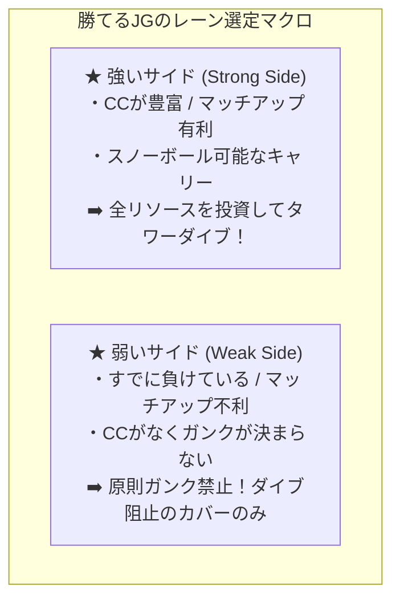

# LoL：負けレーンへのガンクは厳禁！勝率が跳ね上がるJG上級論

ジャングラーをプレイしていて、味方のTOPやBOTから**「ガンクに来てくれ！」「対面にボコられてるから助けて！」**と猛烈なPingを連打された経験は誰にでもあるはずです。

そして、良かれと思ってそのレーンに駆けつけた結果——
**育った敵レーナーに2vs1で返り討ちにされ、ダブルキルを献上してゲームが完全に終わってしまった**……そんな苦い記憶はありませんか？

断言します。
**「1vs1で負けているレーンには、絶対にガンクに行ってはいけません。」**

今回は、チャレンジャージャングラーのHALdesu氏が明かした、上位帯ジャングラーが全員徹底している**「強いサイドの見極め」「タワーダイブの合図」「カバーの真の定義」**というJG上級マクロを完全解説します。

---

## 1. 鉄則：なぜ「負けているレーン」への介入は完全な悪手なのか？

### ① 2vs1でも勝てない（ダブルキル献上リスク）
LoLにおいて、序盤の0/2/0や1アイテム差がついたレーナーは、ステータス・レベルともにモンスター化しています。
そこにレベルが低めのジャングラーが突撃しても、敵のウルトや範囲スキルで一瞬で返り討ちにされ、試合を決定づける特大のシャットダウンを渡すだけです。

### ② 全レーンを勝たせるのは数学的に不可能
ジャングラーのリソース（時間）は限られています。
勝利の鍵は**「全レーンを救うこと」ではなく、「勝てるレーン（強いサイド）を徹底的に破壊して、キャリーを作ること」**です。

負けているレーンは「耐えてもらう（ウィークサイド）」と割り切り、自分が育てた強いサイドの味方（育ったBOTやMID）と一緒に、**後から集団戦で対処するのが唯一の正解**です。

---

## 2. タワーダイブの合図は「巨大ウェーブのクラッシュ時」

上級ジャングラーが行う最も破壊的なガンク、それが**「タワーダイブ」**です。
しかし、適当にタワー下へ突っ込んでもタワーのレーザーで自滅するだけです。

### 成功率100%のダイブ条件
- **合図**: 味方が**「2〜3ウェーブの巨大なミニオン」**を敵のタワー下に押し付けた（クラッシュさせた）瞬間。
- **破壊的な理由**:
  タワー下で敵をキルすると、敵はキルされるだけでなく、**タワーに焼かれて消滅する大量のミニオン（経験値とゴールド）をすべてロスト**します。
  1回のダイブ成功で、実質的に相手は「2キル＋1レベル差」の致命傷を負い、レーン戦がその瞬間に終了します。

---

## 3. ジャングラーの「カバー」の真の定義

ジャングラーの仕事は、敵をキルすること（ガンク）だけではありません。
プロやチャレンジャーが重視する技術に**「ステルスカバー」**があります。

- **シチュエーション**: 味方のレーナーがウェーブを敵タワーへ押し切り、ベースへ帰りたい時。
- **リスク**: このタイミングは、敵ジャングラーから見て最もガンクを刺しやすい「無防備な時間」です。
- **JGのアクション**: 
  レーンには姿を見せず、**「近くの森の茂み（ブッシュ）」に静かに身を潜める**。
  敵JGがガンクに来たら即座にカウンターして返り討ちにし、敵が来なければ味方が安全にリコールを完了するのを見届けて立ち去ります。

この「姿を見せない護衛」ができるようになると、味方レーナーのデスが激減します。

---

## 4. トラッキングと「タイマー待ち伏せ」の心理戦

敵のジャングルキャンプ（ラプターや赤バフ）を奪った時、あなたは何を考えていますか？
**「奪ったキャンプが次に湧く時間」は、世界中であなただけが正確に知っている秘密の情報**です。

1. 敵JGは「自分のキャンプが湧いた頃かな？」と曖昧な感覚でノコノコ歩いてきます。
2. あなたは正確なリスポーンタイマーを把握しているため、**湧く5秒前に敵陣のブッシュで待ち伏せ**します。
3. ファームしようとスキルを吐いた敵JGに全コンボを叩き込み、確実に処刑します。

「予測」を「確定キル」に変える、これこそがチャレンジャージャングラーの思考回路です。

---

## 5. まとめ：今日からJGで勝率を上げる3原則

1. **負けているレーンのPingは無視し、勝てるレーン（強いサイド）に周回を合わせる。**
2. **タワーダイブは「巨大ウェーブがタワーにぶつかった瞬間」だけ狙う。**
3. **味方がリコールしたい押し込み時は、姿を隠して森から護衛（カバー）する。**

Pingに流されて負けレーンへ突撃するのをやめるだけで、あなたの無駄なデスはゼロになり、味方をキャリーして勝利に導く真のジャングラーへ進化できます。

---

> **💡 実戦への問いかけ（思考トリガー）**:
> TOPレーナーが0/2/0で相手のダリウスにタワー下に押し込まれ助けを求めている時、あなたの自陣キャンプはBot側に向かって湧いています。あなたはTOPへ向かいますか？ それともTOPをカバー（ダイブ阻止の牽制）に留め、Botダイブでゲームを動かしますか？
