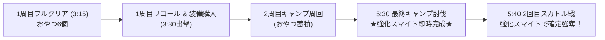

# LoL：JG勝率が激変する「5分30秒スマイト強化」の神業

ジャングラーをプレイしていて、**「相手のジャングラーと常に1レベル差をつけられ、オブジェクト前のスマイト勝負でなぜか毎回負ける」**と悩んでいませんか？

その原因は、あなたの操作精度（ミクロ）ではありません。
**「ゲーム内時計（タイマー）とスマイト強化の仕様」を知らないこと**にあります。

今回は、海外ハイレポジャングラーのGriffin氏が明かした、今シーズンのジャングルで勝率を爆上げする**「5分30秒のスマイト強化タイマー」**と**「ラプタースタート処刑術」**の極秘セオリーを完全解説します。

---

## 1. 5分30秒の奇跡：強化スマイトを2回目のスカトルに合わせる神業

ジャングルペット（幼体）を進化させて「強化スマイト（900 / 1200ダメージ）」にするには、キャンプを狩って**「おやつ（Treats）を20個」**消費する必要があります。

大半のジャングラーは、何も考えずに目の前のキャンプを狩り続けます。しかし、トップ層のジャングラーは以下のように**「5分30秒」**に全てを逆算して合わせています。

### 強化スマイトの数学的内訳
1. **1周目のフルクリア（6キャンプ）**: おやつ6個消費
2. **1体目のスカトル（カニ）**: おやつ1個消費
3. **2周目のキャンプ周回**:
   - ここで重要な仕様があります。**「毎分:30秒（例：3:30, 4:30, 5:30...）に、追加のボーナスおやつが1個ストックされる」**というシステムです。
4. **2周目の最後のキャンプを「5分30秒」まで待って狩る**:
   - 2周目の最終キャンプ（クルーグまたはグロンプ）を5分30秒を迎えた瞬間に狩り切ると、ちょうど**おやつ消費数が「20個」に到達し、その場でスマイトが強化**されます！

### なぜこれが最強なのか？
2体目のスカトルが湧くのは、1体目を両方狩った後の「5分30秒〜6分00秒」です。
敵のジャングラーがまだ普通のスマイト（600ダメージ）を握っているのに対し、**あなただけが「強化スマイト」を所持した状態でスカトル戦およびドラゴン戦に突入**できます。
数値の暴力でオブジェクトのスティール・強奪が100%確定する、プロ直伝の計算ずくマクロです。

---

## 2. 敵の「ラプタースタート」を即座に処刑する3分20秒ルール

もし敵のジャングラーが「赤バフ」ではなく「ラプター（鳥）」からスタートしたのが見えたら、その試合は**開始3分であなたの勝ち（GG）**にできます。

### 処刑のタイムライン
1. **自分は普通にフルクリア（6キャンプ）を完了させる**。
2. **川のカニ（Lv1スカトル）には目もくれず、自陣で即リコールする**。
3. **完成した装備（ロングソード等）を購入し、即座に敵のラプターへ直行する**。
4. **時計が「3分20秒〜3分25秒」を指した瞬間、敵のラプターが再湧きする**。
   - ラプタースタートした敵ジャングラーは、1周目の周回を終えて必ず自分のラプターにノコノコ戻ってきます。
5. **ブッシュで待ち伏せし、装備差・体力差で敵ジャングラーを瞬殺する**。

相手はラプターを失い、キルを取られ、ジャングルが崩壊して二度とゲームに復帰できなくなります。

---

## 3. 今シーズン絶対に覚えておくべきジャングル3原則

Griffin氏が警告する、今シーズンの罠とセオリーは以下の3つです。

1. **Lv1スカトル（最初のカニ）は最弱キャンプ**:
   - 最初のカニはゴールドも経験値も極小です。敵がカニに夢中になっているなら、カニを争わず「敵の逆サイドのキャンプを2つ奪う」方が圧倒的に儲かります。（※ただし時間経過でスケールする2周目以降のカニは最重要）。
2. **クリスタルタワー環境では「グラブより初手ドラゴン」**:
   - タワーの耐久力仕様変更により、序盤のヴォイドグラブの価値は落ちました。初手ドラゴンは非常に柔らかく、2周目フルクリアの直後に湧くため、主導権があれば即狩りして20分ソウルプレッシャーをかけるのが正解です。
3. **敵の3キャンプ即ガンクに釣られてインベードするな**:
   - 敵JGがLv3でサイドレーンにガンクした時、慌てて敵陣に侵入すると1キャンプしか奪えずテンポを失います。自陣フルクリアを優先してキャンプの再湧きタイマーを早め、レベル差をつけてから「後で湧き直した敵キャンプ」を奪う方が遥かに安全で巨大な差がつきます。

---

## 4. まとめ：次の一戦で即実践できるチェックリスト

- [ ] 敵がラプタースタートしたら、カニを無視して3分20秒に敵ラプターで待ち伏せする。
- [ ] 2周目フルクリアの最後のキャンプは「5分30秒」に合わせて狩り、強化スマイトを即完成させる。
- [ ] 最初のカニに命をかけず、自陣のファーム完了と初手ドラゴンの準備を最優先する。

このタイマー管理を身体に染み込ませるだけで、あなたのジャングル勝率は劇的に跳ね上がります。

---

> **💡 実戦への問いかけ（思考トリガー）**:
> 2周目の周回中、5分15秒時点でグロンプ（最後のキャンプ）を殴り始められる状況の時、あなたは無意識に即座に狩り切りますか？ それともあえてHP調整して5分30秒を迎えてから止めを刺し、強化スマイトを完成させて次のスカトルへ向かいますか？
