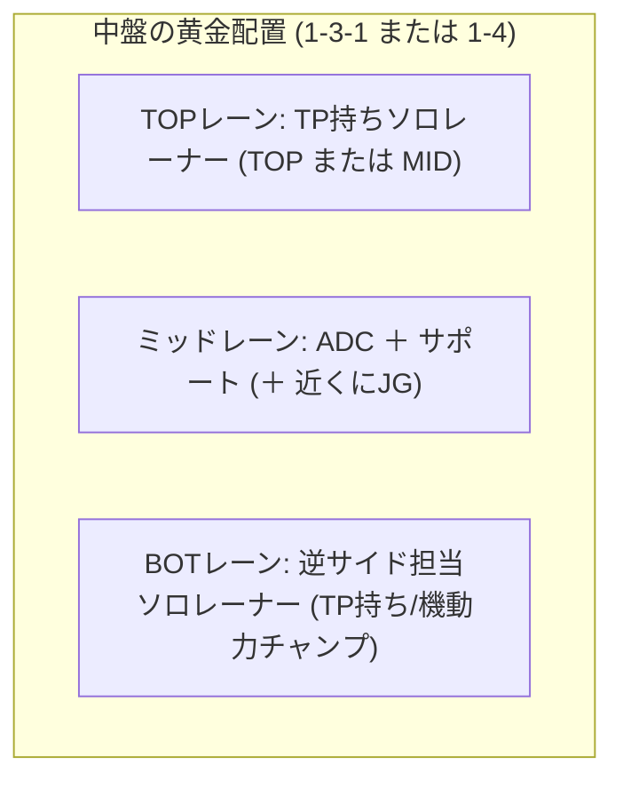

# LoL：中盤の「全員ミッド」をやめて勝率を跳ね上げるサイド管理

シルバー〜エメラルド帯のソロランクで、ファーストタワーが折れた15分前後に**「なぜか両チームの5人全員がミッドレーンに集まり、何分間も睨み合っている」**という光景を嫌というほど見かけます。

通称**「ARAM（All Random All Mid）化現象」**です。

お互いにスキルを適当に撃ち合い、ミニオンのCSを5人で奪い合い、サイドレーンの大量のミニオンがタワーに無駄に焼かれていく——。
断言しますが、**この「中盤にとりあえずミッドに集まる癖」をやめるだけで、あなたのソロランク勝率は劇的に跳ね上がります。**

今回は、なぜ中盤のミッド集合が完全な悪手なのか、そしてプロや上位勢が当たり前に実践している「サイドレーン管理とクロスプレイスプリット」の鉄則を論理的に解説します。

---

## 1. なぜ「全員ミッド集合」は負け組の立ち回りなのか？

### ① チーム全体のゴールドと経験値が半分以下に激減する
1ウェーブのミニオンは約105〜125ゴールド、経験値は約300〜400です。
レーンが3本あるLoLでは、毎分3本のウェーブ＝約350ゴールド＋1,000前後の経験値がフィールドに発生しています。

5人がミッド1本に集まると、**サイドの2レーン分（毎分200G＋700EXP）を完全にドブに捨てている**ことになります。
リードしているチームがこれをやると、サイドのタワーがミニオンに削られ、相手に追いつく猶予（時間）を無料で与える「最大の失速原因」になります。

### ② 事故デス（ワンピック）のリスクが極大化する
狭いミッドレーンに密集していると、マルファイトのウルト、アムムのウルト、ノーチラスのフックなど、範囲CCやイニシエートスキルの絶好の餌食になります。
視界のない川側から挟み撃ちにされ、一瞬でエースを取られてゲームが壊れる典型パターンです。

---

## 2. 正しい中盤のロール配置（マップセオリー）

ファーストタワーが1〜2本折れた「中盤（Mid Game）」に入ったら、マップの担当レーンを以下のように再配置するのが世界の標準セオリーです。

### なぜADCとサポートがミッドに行くのか？
1. **タワーが近く一番安全だから**: 逃げ性能の低いADCがサイドの奥深くに行くと、敵アサシンやJGに瞬殺されます。
2. **ドラゴン・バロンの両方に即座に寄れるから**: マップの中心にいれば、どちらのオブジェクトで事件が起きても最短距離でカバーできます。
3. **ウェーブクリアが速いから**: ADCとサポートが瞬時にミッドウェーブを押し込むことで、相手に防衛を強要し、JGと一緒に川の視界を制圧できます。

---

## 3. 実践：サイドを押してオブジェクトを取る「クロスプレイスプリット」

サイドレーンを担当するソロレーナー（TOPやMID）の仕事は、「敵タワーに突っ込んで死ぬこと」ではありません。
**「相手を1人以上サイドレーンに釘付けにし、逆サイドで人数有利を作ること」**です。

### 黄金のタイムライン
1. **オブジェクト湧く60秒前**:
   - ドラゴンが湧くなら、TPを持つTOPレーナーは**「反対側のTOPレーン」**を強くプッシュする。
2. **オブジェクト湧く30秒前**:
   - 相手は「TOPレーンのタワーを守るために誰か1人を送る」か「タワーを捨ててドラゴンに集まる」の二者択一を迫られる。
3. **オブジェクト発生時**:
   - 相手が守りに来たら：ドラゴン周りは**4v4**になるが、TOPレーナーがTPで合流して**5v4の数的優位**で圧殺する。
   - 相手が守りに来ずドラゴンに5人集まったら：ドラゴンを牽制しつつ遅延させ、TOPレーナーがタワーやインヒビターを折る。

これが、プロシーンやチャレンジャー帯で永遠に使われている「クロスプレイ（反対側での利得回収）」の真髄です。

---

## 4. まとめ：今日からミッドで突っ立つのをやめる3つの行動

1. **タワーが折れたらADC・SUPはミッドへ、ソロレーナーはサイドへ即座に移動する。**
2. **ミニマップを見てサイドウェーブが自陣に溜まっていたら、ミッドで待機せず回収に行く（ただし視界がある安全な位置まで）。**
3. **次のオブジェクトと「逆サイド」のウェーブを押し込み、相手に防衛を強要してからオブジェクトへ合流する。**

ミッドに突っ立って味方とCSを取り合うのをやめた瞬間、あなたの毎分の獲得ゴールドは跳ね上がり、気づけば敵と1〜2アイテム差をつけてキャリーできるようになります。

---

> **💡 実戦への問いかけ（思考トリガー）**:
> 自チームのBotタワーを折った後、敵MIDがミッドに居座り続けている時、あなたはADCとしてBotレーンに留まり続けますか？ それとも味方MIDにPingを鳴らしてミッドを交代し、川の視界を制圧しに行きますか？
