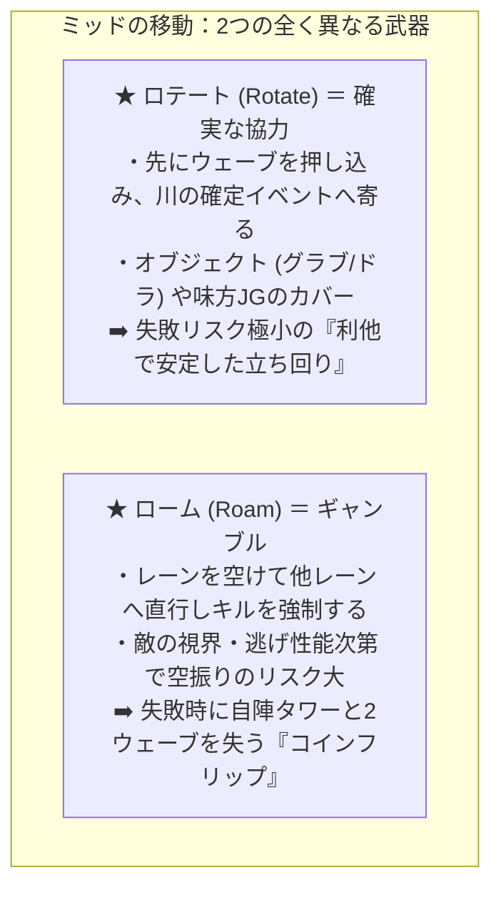

# LoL：ミッドが自滅する「ロテとロームの混同」と正しい寄り方

ミッドレーナーをプレイしていて、**「サイドレーンを助けようとロームしたのにキルが取れず、自陣のタワーを削られてレベル差をつけられて自滅した」**という経験はありませんか？

あるいはジャングラーとして、**「なぜミッドは川のファイトに寄ってくれないんだ！」**とフラストレーションを感じたことはありませんか？

断言します。
**チャレンジャー以上の世界において、ミッドレーンから離れる動きは「ロテート」と「ローム」の2つに厳格に分かれており、これを混同したプレイヤーから順番に自滅していきます。**

今回は、天狐ハク氏が解き明かした、ミッドが永久に主導権を失わないための**「ロテートとロームの完全分離マクロ」**を徹底解説します。

---

## 1. 「ロテート」と「ローム」の決定的な違い

多くのプレイヤーは、レーンを離れる動きを一括りに「ローム」と呼んでいますが、その本質は真逆です。

### ① ロテート（Rotate）：確実な根拠がある動き
- **目的**: ドラゴン、ヴォイドグラブ、川のJG小規模戦など、**「すでに発生している確定利益」**に対して先に寄って数的優位を作ること。
- **条件**: 先にミニオンウェーブを敵タワーへ押し込み、相手ミッドをタワー下に釘付けにした状態で動く。
- **結果**: 相手ミッドはミニオンを処理しなければならず寄れないため、**確実に2vs1や3vs2の数的優位**でオブジェクトやキルを回収できます。

### ② ローム（Roam）：コインを投げるギャンブル
- **目的**: 遠く離れたTOPやBOTへ強引に突撃し、キルを無理やりもぎ取ること。
- **リスク**: 敵にワードで映って引かれた瞬間、ただの往復散歩になります。その間、自陣ミッドタワーは敵ミニオンに削られ、相手ミッドに2ウェーブ分のCSとタワープレートを無料でプレゼントすることになります。

---

## 2. 致命傷：「ウェーブを2体残して消えるミッド」の末路

中低レートで最も多い負けパターンが、**「ミニオンウェーブを完全に処理しきらず、後衛ミニオンを2〜3体残したままロームに出かけること」**です。

これはLoLにおいて最も重い罪です。
1. あなたがサイドへ向かっている間、残った敵ミニオンによって自陣ウェーブがフリーズ（またはスロープッシュ）される。
2. 相手ミッドは悠々とウェーブを押し込み、あなたのタワーを破壊する。
3. ローム先でキルが取れなければ、**経験値1レベル差＋タワープレート300G差**が確定でつき、そのレーン戦は二度と勝てなくなります。

---

## 3. ジャングラーへの警告：「寄れ」と「見てくれ」の不毛論争

ジャングラーとミッドレーナーの間で最も頻発する喧嘩が、**「なぜオブジェクトに寄らないのか」**という問題です。

結論を言います。
**「テンポを作るのはジャングラーではありません。レーンのウェーブ状況です。」**

- **味方ミッドがタワー下でミニオンを捌いている時**:
  ミッドは絶対に寄れません。寄った瞬間に150G＋大量の経験値を失い、レーンが崩壊するからです。
- **JGの鉄則**:
  味方のミニオンが敵タワーにクラッシュしている（＝味方ミッドが動けるターン）のを確認してからオブジェクトを触る。ウェーブを無視してオブジェクトを始めるのは、ギャンブルではなく確定自殺です。

---

## 4. まとめ：今日から勝率を跳ね上げる3箇条

1. **基本は「ロテート（先押しからのオブジェクト協力）」。ハイリスクなロームに逃げるな。**
2. **ウェーブを1体でも残してレーンを離れるな。敵タワー下へ押し切ってから動け。**
3. **味方ミッドがタワー下にいる時は、ジャングラーは絶対に川で戦闘を始めるな。**

この「ロテートとウェーブの同期」を徹底するだけで、あなたのミッド・ジャングル連携は見違えるほど洗練され、無駄なデスや敗北が綺麗さっぱり消滅します。

---

> **💡 実戦への問いかけ（思考トリガー）**:
> ミッドで対面を少し削りましたが、自陣タワー前にミニオンが4体残っています。その時、Bot川で味方JGと敵JGの小規模戦が始まりました。あなたはミニオンを捨てて川へダッシュしますか？ それともウェーブを処理してからPingを鳴らして合流しますか？
