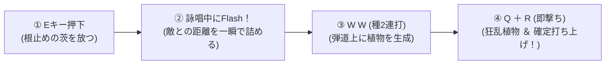

# LoL：プラチナから2週でマスター！ザイラJGの必殺コンボ術

「現在、ソロランクで最もブロークン（壊れ）なAPジャングラーは誰か？」

プロチームBLGのアナリスト・コーチを務めるSungod氏の答えは、迷いなく**「ザイラ（Zyra）」**です。

事実、彼の指導した生徒たちは、
- **シルバーからマスターへ一気に駆け上がる**
- **プラチナからわずか2週間でマスター到達**
- **ザイラをプールに加えてチャレンジャー到達**
という驚異的な実績を叩き出しています。

「周回の最適化（2分53秒フルクリア）が難しそうだから」と食わず嫌いしていませんか？
今回は、Sungod氏直伝の**「Eフラッシュ確定コンボ」**と**「電撃ルーン換装論」**を完全解説します。

---

## 1. ザイラJGが「ぶっ壊れ」と呼ばれる真の理由

ザイラは単なるファーム型メイジではありません。以下の3つの理不尽な強みを持っています。

1. **オブジェクト処理速度が全チャンピオン中最速レベル**:
   植物がドラゴンの攻撃を身代わりで受けてくれるため、**HPを1ミリも減らさずにソロでドラゴンやバロンを爆速で溶かす**ことができます。
2. **視界の霧（フォグ・オブ・ウォー）からの暗殺力**:
   ブッシュの中に潜み、通りかかった敵キャリーにコンボを叩き込むだけで、相手は画面が白黒になるまで何も操作できません。
3. **集団戦のゾーニング性能（拒否力）**:
   敵のエンゲージに対してウルト（締め付けの茨）を敷くだけで、敵前衛の突進を完全にスカすことができます。

---

## 2. 相手が反応できない「E ➔ Flash」必殺キルコンボ

ザイラJGで最も重要なテクニック、それが**「Eスキルの発生フレーム中フラッシュ」**です。

### なぜ「Flash ➔ E」ではなく「E ➔ Flash」なのか？
- **Flash ➔ E の場合**: 相手はフラッシュの音を聞いてからブリンクやフラッシュで避けられます。
- **E ➔ Flash の場合**: スキルの弾道が出始めた瞬間にザイラがワープしてくるため、**相手の反応速度がどれだけ速くても回避不可能**になります。

### コンボの完全手順
1. ブッシュや暗闇から敵に向かって**E**を押す。
2. その直後に敵の至近距離へ**Flash**する。
3. Eが飛んでいる敵の足元に**Wを2つ連打**してツタ植物を生やす。
4. すかさず**Q**と**R**を重ねる。
5. **結果**: 敵はスネア（足止め）で拘束されたまま植物に乱打され、逃げようとした瞬間にウルトでノックアップされて消滅します。

---

## 3. ルーンの極意：魂の収穫 vs 電撃（Electrocute）

一般的な統計サイトでは「魂の収穫」が推奨されがちですが、Sungod氏は**「序盤のファイトを重視するなら電撃へ切り替えよ」**と提唱しています。

| ルーン | メリット | 推奨シチュエーション |
| :--- | :--- | :--- |
| **電撃 (Electrocute)** | Lv3〜Lv4のスカトル戦やガンクでの**瞬間バーストが跳ね上がる** | 序盤から積極的にキルを奪い、敵JGと2v2で勝ちたい試合 |
| **魂の収穫 (Dark Harvest)** | 後半の集団戦で複数キル・スタック回収によりスケールする | 敵がタンク寄り、または中盤以降の集団戦を見据える試合 |

序盤の主導権を握ってゲームを壊したいソロランクでは、電撃ザイラの破壊力は凄まじいものがあります。

---

## 4. まとめ：今日からLPを盛るための3箇条

1. **基本コンボは「E ➔ Flash ➔ W W Q R」。暗闇から相手に反応猶予を与えるな。**
2. **序盤のガンク・2v2で勝ち切るために「電撃」ルーンを試せ。**
3. **オブジェクト（ドラゴン・グラブ）は植物にターゲットを吸わせて無傷で狩り切れ。**

フルクリアの練習を少し積むだけで、ザイラJGはあなたを確実に高レートへと押し上げてくれる最強の武器になります。

---

> **💡 実戦への問いかけ（思考トリガー）**:
> ドラゴン前で敵ADCがコントロールワードを消そうとブッシュに近づいてきました。あなたなら遠くからEを撃ちますか？ それともブッシュの影から「E ➔ Flash ➔ W W Q R」を迷わず叩き込んで瞬殺しますか？
