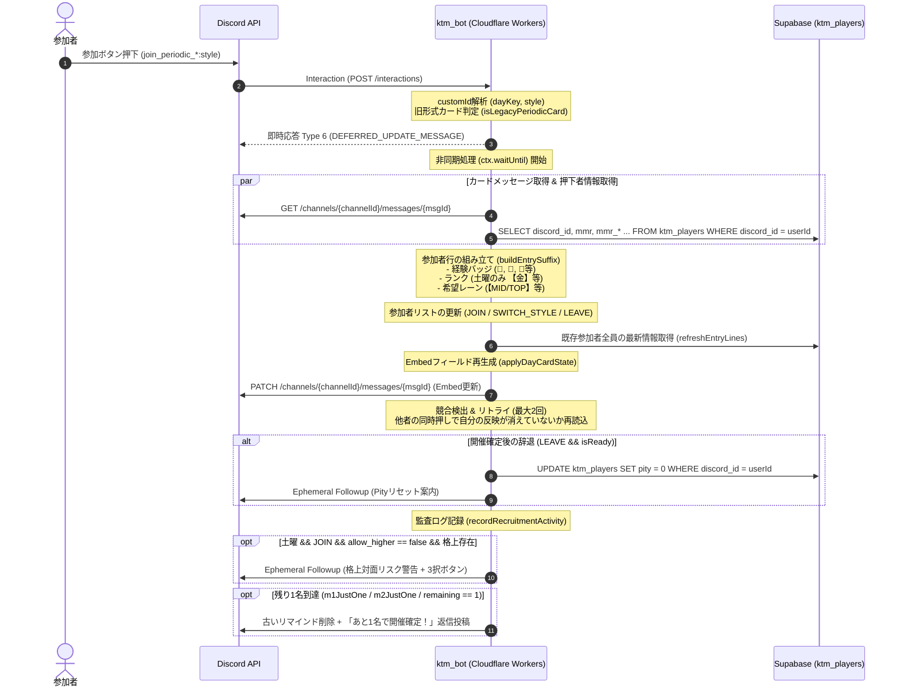
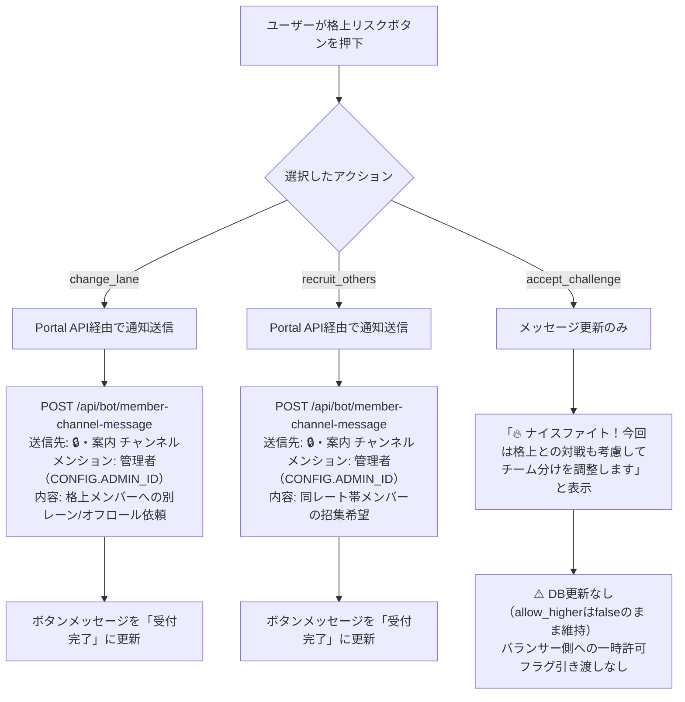

# Discord定期募集 参加フロー・仕様洗い出し調査報告書

- **作成日**: 2026-11-23
- **対象**: `03_SYSTEMS/ktm_bot`（特に `src/handlers/buttons/periodicRecruit.js`, `src/utils/recruitmentStatus.js`, `src/ui/embeds.js`）
- **目的**: 指示文28および指示文29に基づき、Discord側の定期募集カードにおける参加ボタン押下時の処理フロー、バッジ・ランク・MMR取得元、格上対面3択分岐の動作、付随通知、およびPortal側現仕様との食い違いを網羅的に洗い出し、方針決定（案A：Portalプロフィール設定への一本化 / 案B：Discord側機能との併用）のための判断材料を提示する。

---

## 1. 参加ボタン押下時の処理の流れ

定期カスタム（土曜・本戦 / 日曜・お祭り）の募集カードには、以下の5つのボタンが配置されています（`src/ui/embeds.js:478-494`）：
- `🔵 【土曜】フル参加` (`join_periodic_auto:full`) / `🟠 【日曜】フル参加` (`join_periodic_sunday:full`)
- `⏱️ 【土曜】1戦のみ (21:00〜)` (`join_periodic_auto:single`) / `⏱️ 【日曜】1戦のみ (21:00〜)` (`join_periodic_sunday:single`)
- `🌙 【土曜】途中参加 (2戦目〜)` (`join_periodic_auto:late`) / `🌙 【日曜】途中参加 (2戦目〜)` (`join_periodic_sunday:late`)
- `👀 【土曜】観戦希望` (`join_periodic_auto:spectator`) / `👀 【日曜】観戦希望` (`join_periodic_sunday:spectator`)
- `❌ 【土曜】辞退` (`join_periodic_auto:leave`) / `❌ 【日曜】辞退` (`join_periodic_sunday:leave`)

ユーザーがこれらのボタンを押下した際の一連の処理シーケンスは以下の通りです：



### ステップ別詳細
1. **即時応答（Timeout回避）**:
   - `handlePeriodicRecruitButtons` は旧形式カードチェックを通過後、直ちに Discord へ `{ type: 6 }`（DEFERRED_UPDATE_MESSAGE）を返します。これによりDiscord側の「インタラクションに失敗しました」を防ぎつつ、画面に不要なエフェメラル通知を出さずに静かにローディング状態へ移行します。
2. **バックグラウンド処理の開始（`ctx.waitUntil`）**:
   - Cloudflare Workers の制限時間（最大30秒）内で安全に実行するため、以降の重いDB照会・メッセージ再描画処理は `ctx.waitUntil` 内で非同期実行されます。
3. **元メッセージとプレイヤー情報の並行取得**:
   - Discord API から現在の募集カードメッセージを取得（`GET channels/{channelId}/messages/{msgId}`）。
   - Supabase `ktm_players` から押下者のデータを取得（`discord_id=eq.${userId}`）。
4. **参加者行の構築とリスト更新**:
   - 押下者の参加形態バッジ（`🟢フル`、`⏱️1戦のみ`、`🌙途中参加(2戦目〜)`、`👀観戦希望`）を決定。
   - 名簿データを基に `buildEntrySuffix` でバッジ・ランク・希望レーンを付与。
   - `readDayEntryLines` で既存の参加者行配列を取り出し、辞退（`leave`）なら該当行削除、新規なら末尾追加、スタイル変更なら該当行差し替えを行います。
5. **全員のバッジ・ランク修復（`refreshEntryLines`）**:
   - カード内に残っている全参加者の Discord ID を抽出し、Supabase から一括取得。過去のDB停止時などに一時的に「🔰」のまま書き込まれてしまった行や、MMR再計算前の古いランク帯表記を最新状態に上書き修正します。
6. **Embed の更新と Discord PATCH 送信**:
   - `applyDayCardState` で人数カウント・開催判定・タイトル/色・参加者リストを整形し、Discord API に `PATCH` を送信して募集カードを書き換えます。
7. **同時押し競合防止（楽観的ロック・リトライ）**:
   - 複数人が同時にボタンを押した際、後から書き込んだ方で上書きされて一方が消える事故を防ぐため、PATCH 後に 400〜1000ms 待機してカードを再取得。自分のIDが残っていなければ最大2回まで再適用（`applyOnce`）を実行します。
8. **開催確定後辞退のペナルティ処理**:
   - 既に開催条件を満たしている状態（`isReady`）で辞退した場合、公平性維持のため `pity`（希望レーン優先権）を 0 にリセットし、その旨をエフェメラル通知します。
9. **監査ログの記録**:
   - `recordRecruitmentActivity` を呼び出し、誰がどのカードにどのスタイルで参加/変更/辞退したかを DB に記録します。
10. **付随処理（格上警告・あと1名通知）の評価**:
    - 後述の格上対面リスク判定およびラストワン促進メッセージの投稿条件をチェックし、該当すれば後続処理を実行します。

---

## 2. 参加者行のバッジ・ランク・MMRの取得元

参加者行のフォーマット例：
`- <@1234567890> 🟢フル 🥈 【銀】 【MID/TOP】`

### データの取得元
- **テーブル**: Supabase `ktm_players`
- **SELECT句**:
  ```sql
  discord_id, mmr, mmr_top, mmr_jg, mmr_mid, mmr_adc, mmr_sup,
  role_preferences, name, games_top, games_jg, games_mid, games_adc,
  games_sup, metadata, allow_higher
  ```

### 各項目の算出ロジックとタイミング
| 表示項目 | 取得・算出元 | 適用条件・特記事項 |
| :--- | :--- | :--- |
| **経験バッジ**（🔰, 🥉, 🥈等） | `getPlayerExperienceBadge(playerRow).short`<br/>通算カスタム参加試合数（各レーンの `games_*` 合計値）から判定 | 全曜日・全参加者。<br/>名簿未登録者は「🔰」となる。 |
| **ランク表記**（【金】, 【銀】等） | `getHighestLaneMmr(playerRow)` で算出した最高レーンMMRを `getKtmRank(mmr)` に渡し、`RANK_SHORT_JP_MAP` で略称化 | **土曜カードのみ表示**（`def.showRank === true`）。<br/>日曜は「ランク不問のお祭り枠」であるため意図的に非表示。 |
| **希望レーン**（【MID/TOP】等） | `role_preferences`（JSON文字列またはオブジェクト）の `primary` および `secondary` | `ALL` や `FILL` は `ALL` に統一。<br/>第1希望が `ALL` の場合は第2希望を出さない。 |

### 取得のタイミング
1. **ボタン押下時**: 押下した本人について `discord_id=eq.${userId}` で単一取得。
2. **全体リフレッシュ時（`refreshEntryLines`）**: カード上の全参加者IDを `discord_id=in.(${ids.join(',')})` で一括取得。カード上の全行が最新のMMR・ランク・希望レーンで再構築されます。

---

## 3. 格上対面リスク3択分岐の発動条件と選択後の処理

### 発動条件（`periodicRecruit.js:357-376`）
以下の条件が**すべて**満たされた場合にのみ、ボタンを押した本人に限定してエフェメラル通知（`flags: 64`）が送信されます：
1. **土曜カスタムであること**（`dayKey === 'sat'`。日曜は対象外）
2. **新規参加であること**（`activityAction === 'JOIN'`。スタイル変更や辞退時は出ない）
3. **本人の設定が格上拒絶であること**（`playerRow.allow_higher === false`）
4. **カード内の他参加者に格上が存在すること**:
   - カード内の他参加者全員の最高レーンMMRを算出。
   - `oppMmr - myMmr >= 200` を満たす相手が **1名以上** 存在する場合。

### 表示されるエフェメラル通知のUI
- **メッセージ内容**:
  > 🛡️ **【格上との対面に関する確認】**  
  > 現在エントリーしているメンバーの中に、あなたより推定MMRランクが大きく上の方（〇〇さん、△△さん 等）がいます。  
  > あなたの設定は **「🛡️ 格上対面を避ける」** になっています。  
  > より安心してカスタムを楽しめるよう、以下の対応が可能です。ご希望の対応を選んでください：
- **3つのアクションボタン**:
  1. `[Primary]` 🛡️ 格上の方に別レーンをお願いしたい (`higher_risk:${userId}:${dayKey}:change_lane`)
  2. `[Secondary]` 📢 他のメンバーを招集してほしい (`higher_risk:${userId}:${dayKey}:recruit_others`)
  3. `[Success]` ⚔️ 挑戦してみたい (`higher_risk:${userId}:${dayKey}:accept_challenge`)

### 各ボタン選択後の処理詳細（`periodicRecruit.js:110-200`）



#### 選択後の重要な特徴・留意点
1. **他者からの操作防止**:
   - `customId` に埋め込まれた `targetUserId` と実行者の `userId` が一致しない場合、「⚠️ この操作はエントリーしたご本人のみ実行できます」と拒絶します。
2. **管理者への個別チャンネル通知**:
   - `change_lane` と `recruit_others` は、Portalの内部API（`/api/bot/member-channel-message`）を介して、ユーザーの個別案内チャンネル（`🔒・案内`）へ管理者（かずき）宛てにメンションを飛ばします。
3. **DBへの永続化が一切行われない**:
   - `accept_challenge`（挑戦してみたい）を押した場合でも、**Supabase `ktm_players.allow_higher` を `true` に書き換える処理は存在しません**。
   - さらに、今回のマッチ限りの一時フラグを記録するテーブルやフィールドも存在しないため、**バランサー側はこの「挑戦してみたい」の選択を感知できません**。

---

## 4. 「あと1名」通知などの付随処理の発動条件

参加ボタン押下によって参加人数が特定の閾値に達した際、Discordのカードに対して自動でスレッド返信/通常返信が投稿されます（`periodicRecruit.js:420-445`）。

### 発動条件マトリクス
| モード | 条件式 | 投稿される文面 |
| :--- | :--- | :--- |
| **内訳表示あり**<br/>（第1試合・第2試合の内訳） | `nextStatus.breakdown.match1Remaining === 1`<br/>かつ前回状態が 1 以外<br/>かつ新規参加 | `🔥 【${def.shortName}: 第1試合があと1名で開催確定！${rankNote}】`<br/>21:00からの開幕戦にエントリーしませんか？✨ |
| **内訳表示あり** | `nextStatus.breakdown.match2Remaining === 1`<br/>かつ第1試合が成立済み（`isMatch1Ready`）<br/>かつ前回状態が 1 以外<br/>かつ新規参加 | `🔥 【${def.shortName}: 第2試合があと1名で10名到達！${rankNote}】`<br/>2戦目からの途中合流で参加しませんか？✨ |
| **通常モード**<br/>（内訳なし） | `nextStatus.remaining === 1`<br/>かつ前回状態が 1 以外<br/>かつ新規参加 | `🔥 【${def.shortName}: あと1名で開催確定！${rankNote}】`<br/>どなたか最後の1枠で参加しませんか？✨ |

### 付随処理の動作
1. **古いリマインドメッセージの掃除**:
   - `cleanupOldReminderMessages(env, channelId)` を呼び出し、直前にBotが投稿した過去の「あと1名」通知やリマインドを検索して自動削除します（チャンネルのタイムラインがBotの連投で汚れるのを防止）。
2. **募集カードへの参照返信**:
   - `message_reference: { message_id: msgId, fail_if_not_exists: false }` を付与して POST することで、どの募集カードに対するラストワン呼びかけなのかが視覚的にリンクされます。

---

## 5. Portalの現仕様との食い違い一覧および分析（案A vs 案B）

### 食い違い一覧表

| # | 比較項目 | Discord Bot 現行仕様 (`ktm_bot`) | Portal 現行仕様 (`04_PORTAL`) | 発生している問題・構造的ギャップ |
| :-: | :--- | :--- | :--- | :--- |
| **1** | **格上対面の判定基準** | **相対差 200 MMR**（他参加者との最高レーンMMR差が200以上あるか） | **絶対境界 MMR 1450（2帯制）**<br/>・Tier 1（上位帯: 1450以上）<br/>・Tier 2（下位帯: 1450未満） | Botの「200差」は同一帯内（例：1100と1350）でも過剰に反応する一方、1400の人が1460の上位帯と組まれる境界跨ぎでは反応しないなど、Portalの2帯制設計と基準が乖離している。 |
| **2** | **対面保護のSSoT** | エントリー時に都度エフェメラルで警告を出し、3択ボタンで尋ねる | プロフィール設定の **「対面保護（格上対面を避ける）」** を SSoT（単一の真実の源）とする | ユーザーはすでにPortal側で意思表示しているにもかかわらず、Discordで参加するたびに毎回警告ポップアップが表示され、参加の心理的ハードルになっている。 |
| **3** | **挑戦選択時のデータ連携** | `accept_challenge` を押しても、**DBへの書き込みやフラグ保持は一切行われない** | バランサーは `ktm_players` のフラグのみを参照してチームを編成する | ユーザーが「今回は挑戦してみる」と意気込んでボタンを押しても、バランサー側へ情報が渡らないため、マッチング結果に全く反映されない（形骸化している）。 |
| **4** | **繰り上げ・サポート設定** | Bot側には概念なし（3択で管理者に個別チャット通知を飛ばすのみ） | ・**繰り上げ希望**（`tier_promotion_pref`: promote/stay/auto）<br/>・**格下サポート**（`lower_support`: true/false） | Portal側には「人数不足時に上位帯へ繰り上がるか」「下位帯のサポートへ回るか」の自律設定があるが、Discord側のボタンはそれを考慮せず管理者の手動調整を前提としている。 |
| **5** | **運用の自動化度** | `change_lane` / `recruit_others` は管理者にメンションを飛ばし、**人間（かずき）の手動対応を要求する** | バランサーアルゴリズムがプロフィール設定（対面保護・繰り上げ・サポート）を読み込み、**完全自動で公平なチームを編成する** | Bot側の現行フローは、管理者にリアルタイムな個別DM・チャット調整の運用負荷を恒常的に強いる構造になっている。 |

---

### 方針検討：案A（Portalプロフィール設定へ一本化）vs 案B（Discord側機能との併用）

ユーザーおよび開発チームが判断するための両案のメリット・デメリットおよび技術的所見を以下にまとめます。

#### 【案A】Portalのプロフィール設定に完全一本化する（推奨）
- **概要**:
  - Discord側参加ボタン押下時の「格上対面リスク事前警告（3択エフェメラル）」を**完全廃止**する。
  - 参加ボタンは純粋にエントリー受付（参加/辞退/スタイル変更）のみを行う。
  - チーム分け時、バランサーが Portal のプロフィール設定（`allow_higher`、`tier_promotion_pref`、`lower_support`）を直接読み込んで自動的に対面保護・レーン調整・部屋分けを行う。
- **メリット**:
  1. **参加摩擦の極小化**: エントリー時に警告ポップアップが出ないため、参加者が不安にならずスムーズにエントリーできる（「初心者の参加ハードルを下げる」という基本方針に合致）。
  2. **管理者の運用負荷ゼロ**: 参加のたびに `🔒・案内` チャンネルへ管理者が呼ばれて手動調整する作業が完全に消滅する。
  3. **SSoTの一元化とバグの撲滅**: 「Discordで押した選択がDBに反映されない」「BotのMMR判定ロジックとPortalの2帯制判定ロジックがずれる」といった二重管理によるバグが構造的になくなる。
- **デメリット・留意点**:
  - 「今回だけ特別に格上と戦いたい」「今日だけ同格を集めてほしい」という、マッチごとのアドホックな要望をDiscordボタン1つで出すことはできなくなる（ただし、Discordの一般チャットでの会話や、Portal側での事前プロフィール変更で代替可能）。

#### 【案B】Discord側とPortal設定を併用・連動させる
- **概要**:
  - Discord側のエフェメラル通知と3択ボタンを残しつつ、仕様をPortalに合わせる。
  - 発動条件を「相対200差」から「MMR 1450境界および本人の `tier_promotion_pref`」に改修。
  - `accept_challenge` 押下時に、DB（または該当募集回のメタデータ）へ「今回限定の格上許可フラグ」を書き込み、バランサーがそれを解釈できるように改修する。
- **メリット**:
  - ユーザーがPortalを開くことなく、Discordのエントリー画面上でその日の気分に合わせたアドホックな選択を行える。
- **デメリット・リスク**:
  1. **実装・保守コストの増大**: Discord Bot側のWorker処理、Supabaseスキーマ（一時参加設定テーブル等）、Portalバランサーの入力パラメータの3箇所を跨ぐ改修が必要となる。
  2. **通知疲れと離脱リスク**: 参加するたびに毎回警告が出ること自体が、初中級者にとって「自分は場違いなのでは」という心理的抵抗（参加躊躇）を生みやすい。
  3. **管理者の負担残存**: `change_lane` や `recruit_others` を残す場合、結局管理者が手動でメンバー招集や個別チャット連絡を行う運用から抜け出せない。

---

## 6. まとめ・結論（所見）

調査の結果、**現行のDiscord側「格上対面リスク3択分岐」は、Portal側の現行仕様（MMR 1450の2帯制、対面保護、繰り上げ希望、格下サポート希望）と大きく乖離しており、実態としても `accept_challenge` の選択結果がバランサーに渡っておらず形骸化していること**が判明しました。また、残り2つの選択肢も管理者の手動介入を前提とした運用負荷の高い仕組みとなっています。

したがって、**【案A：Portalのプロフィール設定へ一本化し、Discord側の3択ポップアップは廃止する】** 方向が、システムの安定性・管理コストの低減・参加者の心理的ハードル緩和のすべての面において最も合理的であると考えられます。

本報告書を、今後のBotおよびPortalの仕様統一に向けた正式な判断材料として提出いたします。
