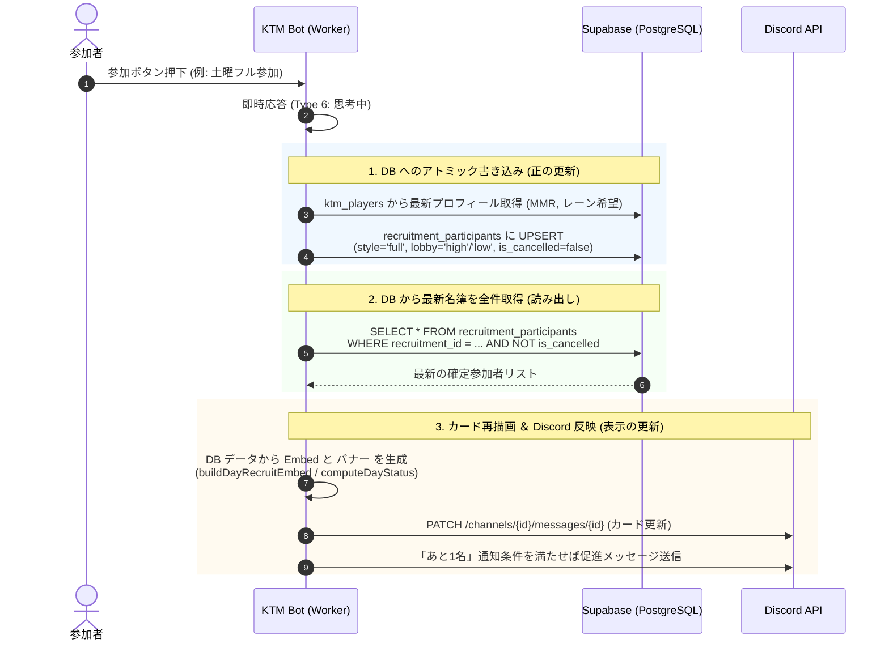

# 調査・設計報告書: 募集台帳のDB化に向けた現状分析とアーキテクチャ設計案

**作成日**: 2026-11-23  
**対象システム**: `03_SYSTEMS/ktm_bot`（および `04_PORTAL` 関連箇所）  
**参照指示文**: `03_SYSTEMS/ktm_bot/docs/specs/34-recruitment-ledger-db-investigation.md`  
**ステータス**: 設計案（※本指示文では実装は行わない）

---

## 1. エグゼクティブサマリー

本報告書は、Discord 募集カードの本文（テキスト）に依存している現行の募集名簿管理を、データベース（Supabase PostgreSQL）を単一の真実の源（SSoT）とする正規アーキテクチャへ移行するための調査結果と設計案をまとめたものである。

### 調査から判明した決定的な事実
1. **`recruitments` テーブルの現状**: 現在テーブルには全 67 行が存在し、直近 50 件中「ノーマル 36 件、定期カスタム 10 件」が記録されている。
2. **過去に 0 件だった原因**: 2026 年 9 月当時、Worker の `SUPABASE_KEY` に `anon`（公開）キーが設定されており、RLS（Row Level Security）の INSERT 拒否によって全件失敗していた。現在は `service_role` キーへの切り替えにより **募集ヘッダー（作成時のレコード）の INSERT 自体は成功している**。
3. **現在も「名簿台帳」として機能していない根本原因**:
   - `recruitments` テーブルには `discord_message_id`, `owner_discord_id`, `mode`, `status` などのヘッダー情報しかなく、**「誰が参加しているか」を保持する名簿カラム（または子テーブル）が最初から存在しない**。
   - 参加・辞退ボタン押下時の処理（`periodicRecruit.js` / `recruitCard.js`）は、**Discord の Embed 本文を読み書きしているだけで、DB への名簿更新処理が 1 行も書かれていない**。
4. **Portal 側への影響**: Portal 側のソースコード内で `recruitments` テーブルをクエリしている箇所は **0 件**。ただし、オンボーディング管理（`periodicCustomCard.ts`）が Discord API 経由でチャンネルメッセージを走査・本文パースして参加者を取得しているため、DB 化によってこの不安定な走査を安全な DB クエリへ置き換えることができる。

---

## 2. 現状調査：recruitments 書き込み不成立の原因特定

### 2.1 実測データ調査結果（2026-11-23 実測）
Supabase データベースの実測クエリ結果：
- **総レコード数**: 67 件
- **直近 50 件の内訳**:
  - `ノーマル`: 36 件
  - `定期カスタム`: 10 件
  - `カスタム`: 2 件
  - `ARAM`: 2 件
- **定期カスタムの最新レコード**:
  - `2026-11-21(土)` 分: `discord_message_id = '1572446420651352087'` / `status = 'open'`
  - `2026-11-22(日)` 分: `discord_message_id = '1572446434123325612'` / `status = 'closed'`
- **RLS ポリシー検証**:
  - `anon` ロールでの INSERT: `new row violates row-level security policy for table "recruitments"` で確実にブロックされる。
  - `service_role`（Bot 実行環境）での INSERT: 正常に通過。

### 2.2 過去に「実測 0 行」だった経緯と根本原因
- **原因 1: API キーと RLS の不整合（2026 年 9 月解決済み）**
  - Worker 環境変数 `SUPABASE_KEY` に anon キーが設定されていたため、全 INSERT が RLS エラーとなっていた。呼び出し元が `catch` で握りつぶしていたため沈黙していた。
- **原因 2: 定期募集の土日分離前の構造的欠陥（2026 年 9 月解決済み）**
  - 旧仕様では 1 メッセージに土日両方が入っていたため、土曜の 1 件しか DB 登録されず、日曜のレコードが構造的に存在しなかった。

### 2.3 現在も「台帳」として機能していない 4 つの構造的理由
ヘッダー行が INSERT されるようになった現在でも、募集名簿として機能していない理由は以下の通りである。

1. **参加者（名簿）を保持するスキーマが存在しない**:
   - `recruitments` テーブルの定義（`09_recruitments.sql`）:
     ```sql
     create table recruitments (
       id                 uuid primary key default gen_random_uuid(),
       discord_message_id text unique,
       discord_channel_id text,
       owner_discord_id   text not null,
       mode               text,
       max_count          int,
       status             text not null default 'open',
       created_at         timestamptz not null default now(),
       updated_at         timestamptz not null default now(),
       start_at           timestamptz,
       reminded           boolean not null default false
     );
     ```
   - ご覧の通り、**参加者の Discord ID、希望レーン、参加形態（フル/1戦のみ/途中参加/観戦）を格納するカラムが一切存在しない**。
2. **ボタン押下時に DB を更新する経路が存在しない**:
   - `periodicRecruit.js`: 参加ボタン押下時、Discord メッセージの Embed 本文を `readDayEntryLines` で取得 ➔ 行を追加/削除 ➔ Discord メッセージを PATCH して終了。DB への問い合わせ・保存は 1 行も存在しない。
   - `recruitCard.js`: 都度募集では Embed の thumbnail URL に仕込まれた不可視クエリ `?metadata=<JSON>` を更新しているだけで、DB の `recruitments` には参加者一覧を一切保存していない。
3. **ライフサイクル・ステータスのドリフト（放置問題）**:
   - 定期カスタムの土曜分（11/21）は、試合が終了しているにもかかわらず `status = 'open'` のまま放置されている（日曜分は 20:00 判定等で `closePeriodicCard` が呼ばれたため `closed` になっている）。
   - DB レコードの終了管理が疎結合であり、完全な自動クローズが担保されていない。
4. **都度募集（スラッシュコマンド・モーダル）におけるベストエフォートの脆弱性**:
   - `/recruit`（`commands.js:53`）やモーダル（`modals.js:54`）では、Discord への投稿後に `ctx.waitUntil` 内で非同期に `createRecruitment` を呼んでいる。
   - しかし、Discord API の Webhook 遅延や Discord 側のメッセージ作成タイミングとの競合、一時的なネットワーク例外が発生した場合、エラーは `console.error` でログ出力されるのみで、Discord 上には募集カードが存在するのに DB には行が存在しない「孤立カード」が発生し得る。

---

## 3. 現状調査：カード本文パースに依存している処理の全量リスト

現在、Bot および Portal において Discord メッセージの本文・Embed をパースして「正」としている処理の全量一覧は以下の通りである。

| No | 処理分類 | 対象ファイル / 関数 | 本文パースに依存している具体的な処理 | 発生するリスク |
| :--- | :--- | :--- | :--- | :--- |
| 1 | **参加・変更・離脱** | `periodicRecruit.js`<br>`handlePeriodicRecruitButtons` | `readDayEntryLines(targetEmbed)` で Embed fields から行配列を取り出し、自分のメンション行を特定・追加・削除・置換する | 同時ボタン押下時の競合（後勝ちによる参加者上書き消失）、パース失敗によるデータ破損 |
| 2 | **名簿再同期** | `periodicRecruit.js`<br>`refreshEntryLines` | 全参加者行から `<@(\d+)>` を正規表現で抽出し、DBから最新のランク・希望レーンを引いて行テキストを再生成する | パースに失敗した行（表記ゆれ等）が 🔰 に戻ったりバッジが消える |
| 3 | **楽観的ロック検証** | `periodicRecruit.js`<br>`applyOnce` ループ | メッセージ PATCH 後に Discord からメッセージを再取得し、Embed 内に自分のメンション文字列が含まれているかテキスト検索（最大3回リトライ） | Discord API のキャッシュ遅延（GET が直前の PATCH を反映していない）による誤リトライ |
| 4 | **あと1名通知判定** | `periodicRecruit.js` | パース前後の行配列から `computeDayStatus` で `match1Remaining` を比較し、1名になった瞬間を検知して緊急通知を送信 | パース結果がズレると誤通知または通知漏れ |
| 5 | **中間リマインド** | `eventNotify.js`<br>`sendEventUsersNotification` | `loadDayRecruitmentSummary` 経由でチャンネルの直近メッセージを取得し、Embed fields をパースして現在の集まり人数を算出 | メッセージが他投稿で流れると取得失敗、パース失敗で人数 0 名と誤認 |
| 6 | **20:00 開催判定** | `eventNotify.js`<br>`checkCustomStatusAt2000` | Embed をパースして第1戦稼働人数・途中参加人数・観戦枠人数を算出。成立/中止を判定し、パースした ID 一覧に集合メンションを発信 | パースが失敗すると人数不足と判定され、誤って中止告知が発信される重大リスク |
| 7 | **二重投稿防止** | `periodicCards.js`<br>`findDayCard` | チャンネル直近メッセージ（15〜50件）のタイトル文字列（`def.emoji` と `target.label`）を走査してカードの有無を判定 | チャンネル内に過去ログが大量にある場合の取得漏れ、別メッセージへの誤マッチ |
| 8 | **前回カード締め切り** | `periodicCards.js`<br>`closePreviousPeriodicRecruitments` | チャンネルを走査してタイトルに「定期カスタム」を含むメッセージを探し、過去日のカードを終了化 | 過去カードの見落としによる古い募集の残留 |
| 9 | **都度募集の参加管理** | `recruitCard.js`<br>`handleRecruitButtons` | thumbnail URL の不可視クエリ `?metadata=<JSON>` または Embed 本文の行をパースして参加者配列（`joined`）を復元・更新 | URL パラメータ文字数制限、Discord 側の URL サニタイズによる破損 |
| 10 | **Portal オンボーディング** | `04_PORTAL/src/lib/`<br>`periodicCustomCard.ts` | Discord API で定期募集チャンネルのメッセージ 50 件を取得し、Embed fields をパースして参加者一覧（`CustomEntryDetail[]`）を復元 | Discord API レート制限、Bot の Embed レイアウト変更に伴うパース破損 |

---

## 4. 現状調査：Portal 側への影響範囲

### 4.1 Portal 側コードベースの調査結果
- **`04_PORTAL` 内の `recruitments` テーブル参照**: **0 件**。
  - 過去のダッシュボード機能（募集アクティビティ）削除に伴い、クエリは完全撤去済み。
- **バランサー（`/balancer`）**:
  - バランサー画面は `ktm_players`（名簿）から選手を読み込み、手動選択または `/api/balancer/pending`（`pending_match_sync`）の試合データを利用。
  - 現在、募集カードからバランサーへの自動選手インポート処理は実装されていない。

### 4.2 Portal 側で唯一 Discord パースを行っている箇所
- **ファイル**: `04_PORTAL/src/lib/periodicCustomCard.ts`
- **利用箇所**: `04_PORTAL/src/app/api/admin/onboarding-channels/route.ts`（オンボーディング管理パネル）
- **処理内容**: 次の定期カスタムのエントリー状況（参加者、希望レーン、ランク等）を表示するため、Discord API でメッセージを取得してパースしている。
- **影響評価**:
  - Bot 側の募集台帳を DB 化しても、既存の Discord Embed 表示形式が維持される限り、`periodicCustomCard.ts` はそのまま動作し続けるため **互換性リスクはゼロ（完全非破壊）**。
  - 将来的には、`periodicCustomCard.ts` を「Discord API 経由のパース」から「Supabase DB からの高速な直接 SELECT」に差し替えることで、Portal 側の表示速度向上と Discord API レートリミット回避が可能となる。

---

## 5. 募集台帳の DB 化設計案

### 5.1 テーブル構成案の比較評価

募集台帳の DB 化にあたり、以下の 3 案を比較検討した。

| 評価軸 | 案A: `recruitments` テーブルの拡張（JSONBカラム） | 案B: 参加者テーブル `recruitment_participants` の新設（正規化） | 案C: ハイブリッド案（推奨） |
| :--- | :--- | :--- | :--- |
| **概要** | `recruitments` に `participants` (JSONB) カラムを追加 | `recruitment_participants` テーブルを新設し、参加者を行単位で管理 | `recruitment_participants`（正規化行）＋ ヘッダーに `participants_cache` (JSONB) |
| **同時実行性（並行押し）** | ❌ 2人が同時に押すと JSONB 全体の上書き競合が発生しやすい | ✅ **PostgreSQL の UPSERT (`ON CONFLICT`) で行単位の完全アトミック更新が可能** | ✅ 行単位の UPSERT で衝突ゼロ。集計用サマリーも即時取得可能 |
| **クエリ・集計性能** | △ JSONB 内の展開が必要。インデックスが複雑 | ✅ `WHERE recruitment_id = ...` で標準的な SQL クエリ・集計が可能 | ✅ 最も柔軟。Portal や分析スクリプトからの集計が極めて容易 |
| **履歴・監査性** | △ 参加・辞退の履歴を追うには別ログが必要 | ✅ レコードの `created_at` や `status`（active/cancelled）で追跡可能 | ✅ 完全な監査ログと即時表示用キャッシュが両立 |

#### 【推奨案】案B（または案C）: 正規化子テーブル `recruitment_participants` の新設
PostgreSQL の最大の強みである **アトミックな行ロックと UPSERT** を活かし、Discord ボタンの同時連打に耐えうる設計とするため、正規化子テーブル `recruitment_participants` の新設を提案する。

```sql
-- 1. 募集親テーブル（既存 recruitments の補強）
ALTER TABLE recruitments ADD COLUMN IF NOT EXISTS target_day text; -- 'sat' | 'sun' (定期募集用)
ALTER TABLE recruitments ADD COLUMN IF NOT EXISTS dominant_tier text;

-- 2. 参加者子テーブル（新設）
CREATE TABLE IF NOT EXISTS recruitment_participants (
  id                  uuid PRIMARY KEY DEFAULT gen_random_uuid(),
  recruitment_id      uuid NOT NULL REFERENCES recruitments(id) ON DELETE CASCADE,
  discord_id          text NOT NULL,
  user_name           text,
  style               text NOT NULL DEFAULT 'full', -- 'full' | 'single' | 'late' | 'spectator'
  lobby               text DEFAULT 'low',           -- 'high' | 'low' (土曜用: MMR 1450境界)
  primary_lane        text,                         -- 'TOP', 'JG', etc.
  secondary_lane      text,
  rank_tier           text,                         -- 'PLATINUM', etc.
  estimated_mmr       int,
  is_cancelled        boolean NOT NULL DEFAULT false, -- 辞退フラグ（履歴保持）
  created_at          timestamptz NOT NULL DEFAULT now(),
  updated_at          timestamptz NOT NULL DEFAULT now(),
  
  -- 1つの募集に対して同一ユーザーは1レコードのみ（UPSERT可能）
  CONSTRAINT uq_recruitment_user UNIQUE (recruitment_id, discord_id)
);

CREATE INDEX IF NOT EXISTS idx_participants_recruitment ON recruitment_participants (recruitment_id) WHERE NOT is_cancelled;
CREATE INDEX IF NOT EXISTS idx_participants_user ON recruitment_participants (discord_id);
```

### 5.2 DB を正とする新しい処理フロー（Single Source of Truth）



### 5.3 定期カスタムの帯ロビー（上位帯/中初級帯）および変則参加の表現形式
- **帯ロビー（`lobby`）の決定**:
  - ボタン押下時に、プレイヤーの推定MMR（最高レーンMMR）に基づき、1450以上なら `'high'`、1450未満（または未登録）なら `'low'` を付与して DB に記録。
  - 日曜は全参加者を `'low'`（または `'all'`）として一律記録。
- **変則参加（`style`）の決定**:
  - フル参加: `'full'`
  - 1戦のみ（21:00〜）: `'single'`
  - 途中参加（2戦目〜）: `'late'`
  - 観戦希望: `'spectator'`
- **辞退時**:
  - `is_cancelled = true` に更新（またはレコード削除）。

### 5.4 二重投稿防止とライフサイクル管理
- **二重投稿防止**:
  - 既に本番配備済みの部分ユニークインデックス `idx_recruitments_unique_regular_custom`（`mode = '定期カスタム' AND start_at`）を活用。
  - チャンネル走査を行わずに、`SELECT id FROM recruitments WHERE mode = '定期カスタム' AND start_at = targetStartAt AND status = 'open'` で即座に既存判定が可能。
- **クローズ処理**:
  - 20:00 判定または翌朝の定例処理で、`UPDATE recruitments SET status = 'closed' WHERE id = ...` を確実に発行。

---

## 6. 移行計画と導入段取り

### 6.1 対象範囲の提案：段階的導入（2 フェーズ構成）

| フェーズ | 対象 | 理由・規模感 |
| :--- | :--- | :--- |
| **フェーズ 1**<br>（最優先・推奨） | **週末定期カスタム**<br>（土曜・日曜） | ・毎週確実に運用されており、帯ロビー制・20:00判定・リマインド・途中参加などパース依存の複雑度が最も高い。<br>・カードが土日の 2 枚に固定されており、境界が明確でテストしやすい。<br>・実測値で最もエラーが致命的になりやすい領域。 |
| **フェーズ 2**<br>（後続展開） | **一般都度募集**<br>（ノーマル/カスタム/ARAM） | ・突発的に複数発生する募集。<br>・現在は `?metadata=<JSON>`（透明ピクセル）で運用されており、大きな破綻は起きていない。<br>・フェーズ 1 の安定稼働を確認した後に同様のテーブル構造で移行可能。 |

### 6.2 段階的移行ステップ（安全な 3 ステージ）

```
[ステージ 1: Dual-Write (並行書き込み)]
  ・ボタン押下時: 既存の本文パース更新を行いながら、同時に DB にも UPSERT する。
  ・読み取り: 依然として本文パースを正とする。
  ・目的: DB 側にデータが正しく溜まるかを実戦で検証（データ損失リスク 0）。
        ↓
[ステージ 2: DB-Primary (DB を正に切り替え)]
  ・ボタン押下時: DB に書き込み ➔ DB から取得してカード本文を再生成。
  ・障害時フォールバック: DB エラー時は既存の本文パース処理へ自動フォールバック。
        ↓
[ステージ 3: 完全移行 ＆ パースコードの撤去]
  ・本文パース依存コード（extractEntryLines 等）を完全に撤去・整理。
  ・Portal 側の periodicCustomCard.ts も DB 直読みに移行。
```

### 6.3 失敗時の切り戻し（フォールバック）戦略
- `recruitment_participants` への書き込みまたは読み取りが例外となった場合、`catch` ブロック内で既存の `readDayEntryLines` による本文パース処理をそのまま呼び出すフォールバック関数を用意する。
- 万が一 Supabase がダウンしても、Discord 側での募集進行が停止しない構造を担保する。

---

## 7. リスクと未決事項（ユーザー判断が必要な論点）

実装を開始する前に、ユーザーに判断・合意をいただくべき論点は以下の 4 点である。

### 論点 1: 過去の `recruitments` レコードの扱い
- **現状**: テーブルには過去のテストデータや `open` のまま残った古い定期カスタム（67件）が存在する。
- **提案**: 移行前に、`start_at < now() - interval '7 days'` の古い `open` レコードを一括で `status = 'closed'` に更新するクリーンアップ SQL を 1 本流すことを推奨。

### 論点 2: 既存の募集カードからの引き継ぎ方法
- **論点**: 新仕様デプロイ時点で既に Discord 上に出ている募集カードがある場合、その参加者をどう DB に取り込むか。
- **選択肢**:
  - **案 2-A（推奨）**: 水曜 12:00 の定期募集カード新規投稿タイミングに合わせて本番適用する（引き継ぎ不要）。
  - **案 2-B**: デプロイ時に既存カードを 1 回だけパースして DB にシード（初期投入）する移行スクリプトを実行する。

### 論点 3: 辞退者のデータ保持方針
- **選択肢**:
  - **案 3-A（論理削除・推奨）**: `is_cancelled = true` として履歴を残す。誰が何時に辞退したか、ドタキャン傾向やアクティビティの分析が可能。
  - **案 3-B（物理削除）**: `DELETE FROM recruitment_participants WHERE ...` で行自体を消す。テーブルがシンプルに保たれる。

### 論点 4: 対象範囲の確定
- **提案**: 本指示文の提案通り、「**フェーズ 1：週末定期カスタム**」のみを先行して DB 化し、都度募集は現状維持とする方針でよいか。

---

## 8. 次のステップ（実装指示文に向けて）

本報告書の内容および上記 4 点の未決事項についてユーザーの承認が得られ次第、以下の実装ステップ（別指示文）へ進むことを推奨する。

1. **マイグレーション SQL の作成**: `recruitment_participants` テーブルの新設と RLS ポリシー配備。
2. **Worker 側の DB 操作ユーティリティ実装**: 参加・変更・辞退の UPSERT 関数および名簿取得関数の作成。
3. **`periodicRecruit.js` の刷新**: DB を正とし、DB データからカード Embed を再描画する処理への改修。
4. **`eventNotify.js` の刷新**: リマインドおよび 20:00 判定を DB 直読みに切り替え。
5. **ドライランおよび実値検証**: `npm run dryrun:recruitment` に DB 連携モックテストを追加して検証。
