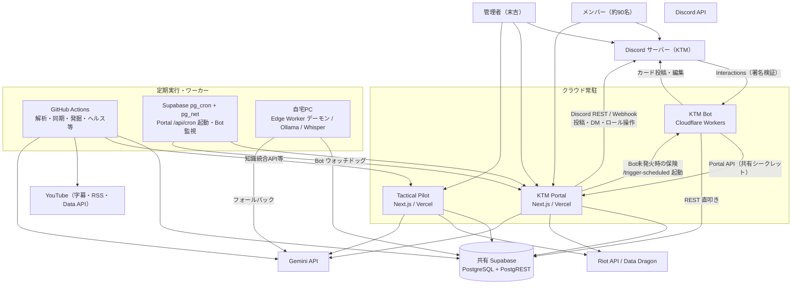
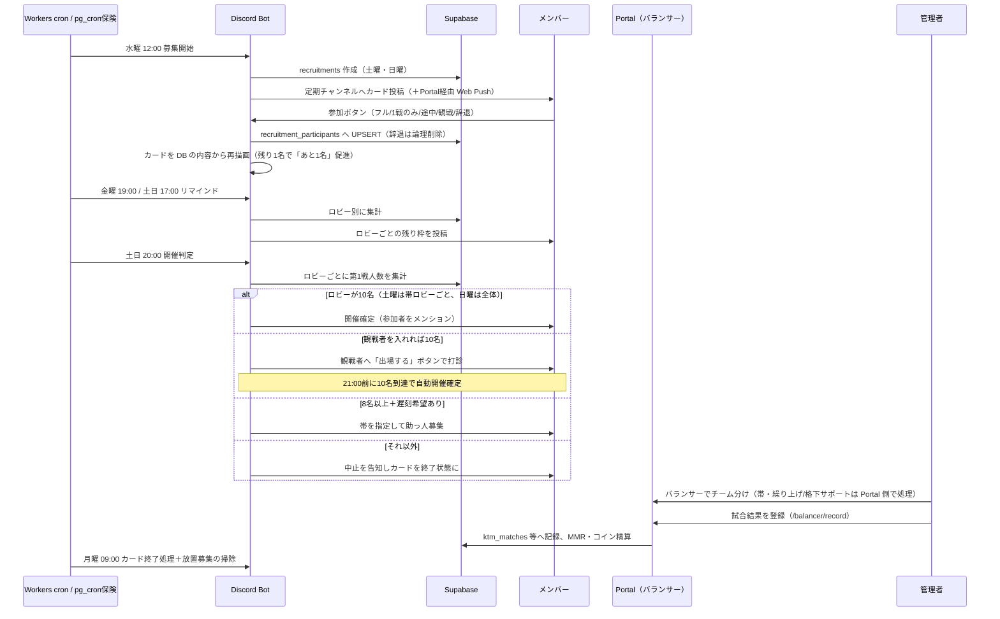
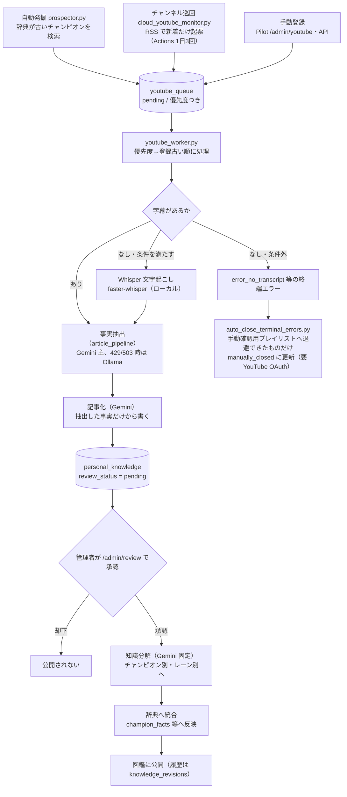
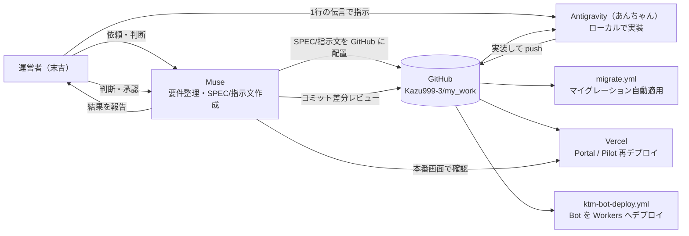

# KTM プロジェクト全体設計書（システムアーキテクチャ）

## 1. この文書について

| 項目 | 内容 |
|---|---|
| 目的 | KTM Portal / Tactical Pilot / Discord Bot / 共有インフラの全体像を、1つの文書で把握できるようにする |
| 対象読者 | 運営者本人（末吉）と、開発を手伝うAI（調整役のClaude、実装担当のAntigravity等）。新しい担当が最初に読む文書という位置づけ |
| 最終確認日 | 2026-11-23 |
| 根拠 | リポジトリ `Kazu999-3/my_work` のコミット `0783150` 時点のコード静的解析。土台は構造メモ4本（Portal / Pilot / Bot / 共有インフラ、いずれも 2026-11-23 調査） |
| 注意 | 本番DB・Vercel / Cloudflare の設定画面・Discord 側の登録状態は見ていない。コードから確定できないものは各所で **要確認** と明記し、§9 に集約した。数値・状態の記述はすべて構造メモの記述に従う。メモ間で食い違う場合は、時系列で新しいメモ（Bot メモは指示文30〜37反映済み）を優先し、その旨を注記した |

## 2. システム全体像

このシステム群は、League of Legends（LoL）コミュニティ「KTM」（約90名）の**運営**と、メンバー（と運営者本人）の**上達支援**のためにある。

- **運営**: 週末定期カスタム（土曜本戦・日曜お祭り）と都度募集の募集〜開催判定〜結果登録〜戦績管理、独自MMRによるチーム分け（バランサー）、コイン経済（カジノ・ベット）、師弟（メンタリング）マッチング、オンボーディング。
- **上達支援**: YouTube 解説動画から自動生成した攻略記事を蓄積するチャンピオン図鑑、AIコーチ、ゲーム中HUD、ソロキューの振り返り。
- **土台**: 3つのアプリ（Portal / Pilot / Bot）が **1つの Supabase プロジェクトを共有**し、プレイヤー名簿・試合・知識を共通データとして持つ。リポジトリはモノレポ（`Kazu999-3/my_work`）で、番号付きフォルダが大分類になっている。

リポジトリの大分類（詳細は infra メモ §1）:

| フォルダ | 役割 |
|---|---|
| `01_INTEL/` | 知識・設計資料（戦術ノート、ガイド、知識ボールト、未整理の受け箱） |
| `02_FACTORY/` | コンテンツ生産と運用記録（下書き、素材、告知文、`DAILY_LOG.md`、`TODO.md`） |
| `03_SYSTEMS/` | 実行系システム（Discord Bot 本体 `ktm_bot/`、運用ツール `TOOLS/`、旧 Python バックエンド `v2_CORE/`） |
| `04_PORTAL/` | KTM Portal 本体。あわせて **共有 Supabase のマイグレーション置き場 `supabase/migrations/`** を内包 |
| `05_PILOT/` | Tactical Pilot 本体 |
| `scripts/`（ルート） | GitHub Actions から走るクラウドワーカーと運用スクリプト群（全92ファイル） |
| `99_ARCHIVE/` | 退役物の保管（旧HUD、旧 Render 構成等） |

## 3. 全体構造図

要点:

- Bot は Discord と HTTP Interactions でつながる（Gateway の常駐接続は持たない）。Portal も Discord REST API / Webhook を直接使うため、Discord 連携は Bot 経由だけではない。
- Portal → Bot の矢印は「保険」: Bot の Cloudflare cron が発火しなかった場合に、pg_cron のウォッチドッグが Portal 経由で Bot を再起動する二重化がある（§7）。
- Pilot と Portal の直接の HTTP API 連携は薄く、接続の主軸は共有 Supabase（§5）。Pilot 側メモでは「HTTP API での直接連携はコードから確認できなかった（要確認）」とされている。

## 4. コンポーネント別設計

### 4.1 KTM Portal（`04_PORTAL/`）

| 観点 | 内容 |
|---|---|
| 役割 | コミュニティ運営ポータル。大会・定期カスタム運営、MMRバランサー、コミュニティハブ（プロフィール・ランキング・ガイド・Web Push）、カジノ、メンタリング、お祭り |
| 技術 | Next.js 16.4.6（App Router）+ React 19.2.8 + TypeScript 5、Tailwind CSS 4、Supabase JS 2.111、web-push（VAPID）。Vercel（リージョン hnd1＝東京）。本番 https://my-work-8jbd.vercel.app |
| 認証 | メンバー＝Discord OAuth2＋署名付きCookie。管理者＝パスワード＋署名付き `admin_session` Cookie（ゲートは `src/proxy.ts`）。Bot→Portal API＝共有シークレット `PORTAL_BOT_SECRET`（§8） |
| 主要機能 | バランサー（チーム分け・勝敗予想、`/balancer`）、結果登録（`/balancer/record`）、マイページ（プロフィール・希望設定・総合カルテ）、ランキング、カジノ（ベット・スロット等）、メンタリング掲示板、お祭りテーマ投票、管理ダッシュボード（`/ktm-admin`） |
| データ | 共有 Supabase の最大の利用者。名簿 `ktm_players`、試合 `ktm_matches` / `ktm_match_participants`、メンタリング、コイン、募集台帳、知識系までほぼ全域を参照（§5） |
| 連携点 | Discord REST / Webhook（投稿・DM・ロール同期）、Bot との相互接続（§4.3）、Riot API / Data Dragon（ランク・チャンピオンデータ同期）、Gemini（コーチ・知識系）、Web Push、Pilot とはリンク導線と共有 DB |

補足:

- 通貨「コイン」の定義（新規登録の初期 1,000、メンタリング初回登録ボーナス 500 等）は `src/lib/constants/rewards.ts` が単一の出所。
- 帯分け（SPEC 10）は `src/lib/balancer/tierBand.ts`（2帯制、境界は Portal MMR 1450、格上許可 `tier_promotion_pref` の3値、格下サポートのオフレーン規則）。次世代バランサー `nextGenBalancer.ts` は未採用/検証用で、現行との関係は **要確認**（§9）。
- トップページ `/` のみ未ログイン閲覧可。それ以外はログイン前提。管理 API は `/api/admin/*` に集約。

### 4.2 Tactical Pilot（`05_PILOT/`）

| 観点 | 内容 |
|---|---|
| 役割 | LoL 上達支援アプリ。チャンピオン図鑑、動画解析による記事自動生成、AIコーチ、カスタムHUD |
| 技術 | Next.js 16.4.6 / React 19.2.8 / Tailwind CSS 4。Vercel（hnd1）。本番 https://ktm-pilot.vercel.app。開発ポート 3005 |
| 認証 | 合言葉（パスフレーズ）＋ HMAC 署名付きセッション Cookie（30日・スライディング、失効可、ログイン試行のレート制限あり）。fail-closed 設計（§8）。一般公開ではなく合言葉の内側のみ |
| 主要機能 | 図鑑トップ（`/`、173チャンピオンの JSON ＋ Supabase の事実データ）、AIコーチ（`/coach`：対面分析・習慣ラダー・目標/ミッション・自由質問）、HUD（`/overlay`、LoL Live Client Data API 接続）、攻略ライブラリ、note 下書き管理、管理画面（記事承認 `/admin/review`、YouTube キュー管理、辞典ヘルス/メンテナンス、運用ダッシュボード） |
| データ | `personal_knowledge`（生成記事の本体、参照37件）、`youtube_queue`（解析キュー）、`champion_facts` 等の辞典系、`reference_items`（参考資料164件、UI は無く投入は CLI）、コーチ系。静的データとして `src/data/` の JSON 群（ビルド時にコンパイル） |
| 連携点 | 共有 Supabase 経由で Portal / Bot と接続。YouTube（yt-dlp / RSS / Data API OAuth）、Gemini（生成系の主担当）、Ollama（自宅PC、補助）、Riot API / Data Dragon / LoLalytics |

LLM の役割分担（Pilot メモ §2）: 生成系は Gemini が主担当。Ollama（qwen2.5:7b）はワーカー側「事実抽出」工程のフォールバック（Gemini の 429/503 時）。知識分解は品質理由で Gemini 固定。本番 Vercel からは自宅PCの Ollama に到達できないため、本番 Web 側の実効は Gemini。

### 4.3 Discord Bot（`03_SYSTEMS/ktm_bot/`）

| 観点 | 内容 |
|---|---|
| 役割 | KTM の Discord サーバー運営 Bot。週末定期カスタムの募集運営の自動化、都度募集の管理、Portal への玄関口（IGN・レーン登録、戦績、コイン、師弟の入口）、オーナー専用の管理操作の実行口 |
| 技術 | Cloudflare Workers（サーバーレス、常駐プロセスなし）。ワーカー名 `ktm-os-worker`（`package.json` 側の表記は `ktm-sovereign-worker` で不一致＝既知事項）。Discord Interactions の HTTP エンドポイント方式（Ed25519 署名検証）。ストレージは Supabase のみ（KV / D1 / R2 等は無し） |
| 認証 | Discord 署名検証に加え、認可は2層：オーナーのみ（`CONFIG.ADMIN_ID`：結果修正・MMR調整・ランク同期・MMR初期化）、管理者IDs（`env.ADMIN_DISCORD_IDS` ＋オーナー：募集カード管理のフォールバック等）。スラッシュコマンド自体に管理者専用のものは無い |
| 主要機能 | 定時ジョブ5本（§7）、スラッシュコマンド9件（welcome / ign / lane / recruit / stats / ranking / coins / casino / tip）、定期・都度募集カードのボタン/モーダル群、通知（DM は一切送らず、個人宛ては Portal 経由で個別案内チャンネルへ） |
| データ | Supabase を REST 直叩き。台帳は `recruitments`（ヘッダー）＋ `recruitment_participants`（参加者台帳＝正）。名簿 `ktm_players` は主に読み取り（直接書き込みは pity リセットのみ）。実行記録 `bot_cron_runs` に書き込む |
| 連携点 | Portal API（`fetchPortalAPI`、§5.2 相当の接続一覧は Bot メモ §5.2）、Discord API v10（投稿・編集、ロール付け外し）、Portal プロフィール設定の読み取り（希望レーン等。ただし `tier_promotion_pref` / `allow_lower_support` は Bot 内に参照が一切無く、帯の穴埋め判断は Portal / バランサー側で完結） |

募集運営の要点（2026-11-23 時点の最新仕様。指示文30〜37 反映済み）:

- **大前提**: 上位帯と中初級帯は基本的に完全に分けて、それぞれ10人集める（独立した2ロビー）。繰り上げ・格下サポートは不足時の穴埋めで Portal バランサー側の処理。
- 土曜（本戦）は1枚のカードの中で2ロビー制（各10名、境界は推定MMR 1450、未設定者は中初級帯）。日曜（お祭り）は「ランク不問」のため単一プール10名。参加者一人ひとりの行の表示形式は従来どおり。
- 参加・変更・辞退は DB に記録し、カードは DB の内容から再描画する（表示は DB の投影）。DB に行が無い古いカードは従来の本文パースにフォールバック。
- かつての Discord 上の「格上サポート3択」は全廃済み（案A）。希望は Portal のプロフィール設定からバランサーが読む。

### 4.4 ワーカー群（ルート `scripts/` と GitHub Actions）

| 観点 | 内容 |
|---|---|
| 役割 | 動画解析パイプラインの実行体、各種同期・発掘・保守・ヘルスレポート。Pilot と一体のものと、Portal / Bot / コミュニティ支援のものが同じ `scripts/` に同居（全92ファイル） |
| 技術 | Python / Node スクリプト群。実行基盤は主に GitHub Actions、一部は自宅PC |
| 主要なもの | `youtube_worker.py`（解析ワーカー本体）、`article_pipeline.py`（事実抽出＋記事化の2段階生成）、`llm_fallback_adapter.py`（Gemini⇔Ollama 切替）、`whisper_transcriber.py`（字幕なし動画の文字起こし）、`prospector.py`（動画の自動発掘）、`cloud_youtube_monitor.py`（チャンネル RSS 巡回）、`auto_close_terminal_errors.py` / `clean_youtube_queue.py`（解析不可動画の後始末）、`seed_reference_items.py`（参考資料の投入 CLI）、`sovereign_supervisor.py`（ローカル常駐の統合管理）、`edge_cloud_worker.py`（`edge_tasks` のオンデマンド処理） |
| 注意 | YouTube 解析の定期実行（Actions の `youtube` ジョブ）は 2026-07-31 に停止済みで現在は手動実行のみ。ローカル常駐の具体的な起動方式は **要確認**（§9） |

### 4.5 共有 Supabase

| 観点 | 内容 |
|---|---|
| 役割 | Portal / Pilot / Bot / ワーカー群が共有する唯一の DB（PostgreSQL + PostgREST）。プレイヤー・試合・募集・知識の共通データ置き場 |
| 管理 | マイグレーションの正の置き場は `04_PORTAL/supabase/migrations/`（全147ファイル、01〜142。Pilot 分も含め全アプリ分を集約）。master への push で GitHub Actions `migrate.yml` が `scripts/migrate.mjs` を実行し、未適用分を番号順に適用（適用済みは DB 内 `_migrations` に記録） |
| 接続 | Web アプリは anon キー（ブラウザ/一般用）と service_role（サーバー用）を使い分け。Bot は REST を直接叩き、service_role 相当のキーで書く。pg_cron + pg_net で DB から外部 HTTP を定期的に呼ぶ処理もある（鍵は Vault） |
| その他 | Edge Functions は現行なし（2026-06 に作った4本は削除済みで、定期実行は pg_cron + pg_net に寄せている）。ルート直下 `supabase/` は CLI 設定と初期統合スキーマの置き場で、継続的なマイグレーション置き場ではない |

## 5. データ設計

### 5.1 主要テーブルのアプリ別利用マトリクス

凡例: R＝読み、W＝書き、参照＝コード内参照はあるが読み書きの内訳まで確定していないもの（Portal メモの方針）、－＝参照なし/対象外。

| テーブル | 役割 | Portal | Pilot | Bot | ワーカー（scripts） |
|---|---|---|---|---|---|
| `ktm_players` | プレイヤー名簿マスタ。レーン別MMR、推定MMR、希望設定（`role_preferences`、`allow_higher`、`tier_promotion_pref` 等）、IGN、pity | 参照（出現100件、最大の利用者） | R（共有参照） | R（バッジ・帯判定・未設定判定）/ W は pity リセットのみ | 監査・補正系スクリプトが参照 |
| `ktm_matches` / `ktm_match_participants` | 試合と参加者（結果・戦績の核） | 参照（42件 / 38件） | R（運用ダッシュボード・試合履歴） | R（`/ranking` 集計、停止中の週間レポート） | 試合監視・監査系が参照 |
| `recruitments` | 募集ヘッダー（message_id、owner、mode、status） | 参照（オンボーディング取得の起点） | R（共有参照） | R / W（作成と status 更新） | － |
| `recruitment_participants` | **参加者台帳（正）**。1募集×1ユーザー1レコード。style（full/single/late/spectator）、lobby（high/low/all）、希望レーン、ランク帯、推定MMR、辞退フラグ `is_cancelled`（論理削除） | R（指示文37で Discord 走査から DB 読みに移行） | R（共有参照） | R / W（UPSERT・論理削除。書き込みは Bot の service_role のみ） | － |
| `personal_knowledge` | 生成記事・ナレッジの本体。`review_status`（pending / approved 等）で承認管理 | 参照（7件） | R / W（パイプラインの中心。参照37件） | －（旧・知識承認ボタン経由の直接書き込みは指示文33で撤去済み） | W（`youtube_worker.py` が生成結果を保存） |
| `reference_items` | 参考資料ライブラリ（全164件）。適用可否の評価付き | － | R（検索のみ。UI なし） | － | W（`seed_reference_items.py` で投入・管理） |
| `youtube_queue` | 動画解析キュー。status: pending / completed / error_generation / error_no_transcript / failed / manually_closed、priority（high/medium/low） | 参照（2件） | R / W（管理画面・API。参照28件） | － | R / W（発掘・巡回が起票、ワーカーが処理・更新） |
| `youtube_channels` / `youtube_playlists` | 巡回対象チャンネル（active フラグ）/ プレイリスト | 参照（各2件） | R | － | R / W（RSS 巡回、解析不可動画の退避先管理） |
| `champion_facts` / `champion_fact_claims` | 辞典の事実データと主張単位（知識統合の反映先） | 参照 | R / W（統合で反映） | － | 更新系スクリプトが参照 |
| `knowledge_revisions` | 知識の編集・統合履歴 | 参照（1件） | R / W（承認画面の履歴表示の元） | － | － |
| `edge_tasks` | オンデマンドタスクのキュー | 参照（46件、投入側） | 参照（37件） | － | W/R（Edge Worker が処理） |
| `bot_cron_runs` | Bot 定時ジョブの実行記録（ウォッチドッグ用） | 参照（未実行の検知） | － | W（開始時 POST、終了時 PATCH） | － |
| `ktm_settings` | 共有設定（日曜お祭りテーマ、ロール同期設定等） | 参照（25件） | R（共有） | R | － |
| `recruitment_activity_logs` | 参加・離脱・代理追加の監査ログ | 参照（1件） | R（共有参照） | W | － |
| `mentorship_profiles` / `mentorship_matches` | 師弟プロフィールとマッチング | 参照（30件 / 47件） | － | 経由（Portal API 越しに登録・引き受け） | － |
| `coin_transactions` / `mines_sessions` 等 | コイン台帳・カジノセッション | 参照（残高更新は RPC `apply_player_coin_delta` 経由） | － | 経由（Portal API 越し） | 監査系が参照 |
| `coach_analyses` / `coach_missions` | コーチの分析結果・ミッション | 参照（2件） | R / W | － | － |
| `matchup_sentinel` | 対面相性の監視・検証 | 参照（16件） | 参照（26件） | － | － |
| `soloq_match_history` 等 | ソロQ履歴・LP・振り返り | 参照 | R / W | － | 同期系が書き込み |
| `gemini_response_cache` / `api_usage_logs` | AI 応答キャッシュ・API 利用ログ | 参照 | 参照 | － | 参照 |

注: テーブルごとの読み/書きの厳密な切り分けと RLS ポリシーの現行状態は、マイグレーション履歴からの追跡が必要で **要確認**（§9）。ただし `recruitment_participants` については、RLS 有効・読み取り公開・書き込みは Bot の service_role のみ（anon の INSERT が拒否される）ことが指示文36で実測確認済み。

### 5.2 データの流れの要点

- **名簿は1つ**: `ktm_players` が3アプリ共通のマスタ。Portal がプロフィール設定の持ち主で、Bot はそれを読んで募集運営に使い、バランサー（Portal）が帯の穴埋め判断まで含めて読む。
- **募集は DB が正**: 台帳DB化（指示文35・37）以降、参加者情報の正は `recruitment_participants`。Discord カードと Portal のオンボーディング表示はどちらも DB の投影。古いカードのみ本文パースにフォールバックする移行期の互換が残る。
- **知識は Pilot が生産し、共有 DB に蓄積**: 動画パイプラインが `personal_knowledge` に記事を生み、承認・分解・統合を経て `champion_facts` 等の辞典データになる。Portal も知識系テーブルを参照する。
- **マイグレーションは1か所**: どのアプリのテーブルでも、変更は `04_PORTAL/supabase/migrations/` に番号付き SQL を追加し、push で自動適用される流れに乗る。

## 6. 主要フロー図

### 6.1 週末定期カスタムの流れ

補足: Bot の cron が発火しなかった場合は、pg_cron ウォッチドッグが `bot_cron_runs` の未実行を検知し、Portal の `/api/cron/bot-backup` 経由で Bot の `/trigger-scheduled` を叩いて補完する（§7）。

### 6.2 Pilot 動画解析パイプライン

補足:

- 解析の定期実行（Actions `youtube` ジョブ）は 2026-07-31 に停止済みで現在は手動実行のみ。統合の定期実行は Actions `dict-sync` ジョブ（3時間おき）が Pilot の `/api/knowledge/integrate` を叩く。
- Gemini の上限に達している間はワーカーが処理を見送る（クォータ一時停止）。失敗ステータスは生成失敗 `error_generation`、字幕なし `error_no_transcript`、`failed` 等。`manually_closed` は再キュー対象外。

### 6.3 開発フロー

要点:

- 役割分担は「Muse＝調整・記憶（要件、SPEC、差分レビュー、本番確認）」「Gemini＝深掘り調査」「Antigravity＝実装」。受け渡しは GitHub 経由（SPEC/指示文ファイルをリポジトリに置き、運営者が1行の伝言を relay する）。
- SPEC/指示文は、対象ファイルと対象外を明示し、未決事項は「勝手に決めず報告のみ」とする形式。破壊的処理は dry-run 先行が原則（Bot では `npm run dryrun:recruitment` が完了条件に使われる）。
- デプロイの連鎖: push すると、マイグレーション適用・Vercel 再デプロイ・Bot デプロイがそれぞれ自動で走る。ローカルからの正規入口は `deploy.bat`（Portal のビルド→commit→push）。
- 実装担当の `DAILY_LOG.md` は作業記録として有用だが、ユーザー指示・合意があったという主張は鵜呑みにせず、都度本人に確認する運用（過去に未確認の合意主張があったため）。

## 7. 運用・定期実行の一覧

定期実行の担い手は4系統に分散している: Cloudflare Workers cron（Bot 本体）、Supabase pg_cron、GitHub Actions、自宅PC。

### 7.1 Bot の定時ジョブ（Cloudflare Workers cron、全5本）

| JST日時 | 処理 | 状態 |
|---|---|---|
| 水曜 12:00 | 週末定期カスタム募集の開始（前週カード削除、土曜・日曜カード投稿、Web Push） | 稼働 |
| 金曜 19:00 | リマインド（土日両日分） | 稼働 |
| 土・日曜 17:00 | リマインド（当日分） | 稼働 |
| 土・日曜 20:00 | 開催判定（ロビーごと） | 稼働 |
| 月曜 09:00 | 前週末カードの終了処理＋放置募集の掃除（6時間超の都度募集も対象）。週間レポートは停止中 | 部分稼働 |

### 7.2 Supabase pg_cron（DB から Portal / Bot を起動）

| ジョブ（メモ記載分） | 内容 |
|---|---|
| `poll-soloq-coach`（15分おき等） | Portal `/api/cron/soloq-coach`（ソロQ振り返り検知） |
| `poll-onboarding-intros`（5分/時1回） | Portal `/api/onboarding/process-intro`（自己紹介の処理） |
| `poll-onboarding-channels`（5分おき/時1回） | オンボーディングチャンネル監視（DB関数） |
| `dispatch-edge-cloud-worker`（5分おき） | `edge_tasks` のディスパッチ（Actions の workflow_dispatch 即時発火も可） |
| `bot-backup-*` / `bot-watch-*` | Bot 定時ジョブの未実行を検知し、Portal `/api/cron/bot-backup` 経由で Bot を補完起動。保険後も未実行なら管理者へ通知 |
| `purge-old-edge-tasks`（週1） | 古い `edge_tasks` の掃除 |
| `legacy-article-reanalysis`（日次） | Pilot 側の再解析キュー投入と推定 |

※ pg_cron の式は UTC 表記。現在有効なジョブの実一覧は DB 側の状態に依存し **要確認**（§9。過去に旧ジョブの停止マイグレーションも行われている）。

### 7.3 GitHub Actions（全21ファイル、主なもの）

| ワークフロー | スケジュール等 | 役割 |
|---|---|---|
| `migrate.yml` | push（migrations 変更時）＋手動 | マイグレーション自動適用 |
| `ci.yml` | push / PR | Portal / Pilot のテスト、Bot の構文チェック＋バンドル検証 |
| `ktm-bot-deploy.yml` | push（Bot 変更時）＋手動 | Bot を Cloudflare Workers へデプロイ |
| `ktm-cloud-worker.yml` | dict-sync 3時間おき、prospect 1日3回 ほか | 辞典同期・動画発掘。YouTube 解析ジョブの定期実行は停止済み（手動のみ） |
| `youtube-monitor.yml` | 1日3回（08:00 / 14:00 / 20:00 JST） | チャンネル新着監視とキューへの自動投入 |
| `portal-weekly-crons.yml` | 毎日 20:00 JST、毎週月曜 09:00 JST、毎週火曜 00:00 JST | Portal の定期処理の肩代わり（自己紹介チェック、sync-matches、freshness-check） |
| `soloq-history-sync.yml` | 毎日 05:40 JST | 前日夜のソロQ履歴取り込み |
| `health-report.yml` | 毎日 06:30 JST＋手動 | 本番ヘルスレポート |
| `db-backup.yml` | 毎週月曜 03:00 JST＋手動 | DB バックアップ（無料枠の Egress 対策で毎日→週1に変更された経緯あり） |
| `edge-cloud-worker.yml` | 毎時 | クラウド側 Edge タスク処理 |
| `champ-dict-update.yml` / `lane-role-update.yml` / `rank-benchmark-update.yml` / `riot-jungle-timing-update.yml` / `patch-watchdog.yml` / `tactics-db-sync.yml` | 週次〜日次 | 辞典・レーン適性・ベンチマーク・ジャングルタイミング・パッチ監視・戦術 DB→Git 同期 |
| `sentinel.yml` | 毎日 12:00 JST＋push | 健全性監視系（実行ステップ詳細は未精査＝**要確認**） |
| `smoke-test.yml` / `ktm-bot-cron-backup.yml` / `soloq-coach-poll.yml` / `absorber.yml` | 定期実行は休止/停止中（手動のみ等） | 本番スモークテスト、Bot cron バックアップ（現在は pg_cron 側が担う）、ソロQコーチ polling、Whisper 救済 |

### 7.4 自宅PC（ローカル）

| 担い手 | 役割 |
|---|---|
| Edge Worker デーモン（`03_SYSTEMS/v2_CORE/edge_worker_daemon.py`） | 字幕なし動画の Whisper 文字起こし等、PC でしかできない処理。起動はルートの `start_all.bat` / `start_all.ps1`（現在はこのデーモンの起動のみ） |
| `sovereign_supervisor.py` | ローカル常駐サービス（Edge Worker、Match Watcher、HUD）の死活監視と自動再起動 |
| Ollama（qwen2.5:7b） | 事実抽出のフォールバック用ローカル LLM |
| `deploy.bat` | デプロイの正規入口（ビルド→commit→push、§6.3） |

## 8. セキュリティと権限の要点

### 8.1 認証方式の違い

| システム | 認証 | セッション/検証 | 備考 |
|---|---|---|---|
| Portal（メンバー） | Discord OAuth2 | 署名付き Cookie（旧来の無署名 base64 から署名方式へ移行済み）。OAuth state の検証あり | トップページのみ未ログイン可 |
| Portal（管理者） | パスワード（`ADMIN_PASSWORD`） | 署名付き `admin_session` Cookie。`/admin`・`/api/admin` は `src/proxy.ts` のゲートで保護 | 管理者 Discord ID の併用あり |
| Portal（Bot→Portal API） | 共有シークレット `PORTAL_BOT_SECRET`（ヘッダ `x-bot-secret` 等） | `verifyBotSecret` で検証 | **未設定時は fail-open になる設計**。本番に設定済みかは **要確認**（§9 最重要） |
| Portal（cron） | `CRON_SECRET`（Bearer） | `/api/cron/*` の保護（`bot-backup` で確認。他も同形式かは要確認） | pg_cron / Actions から呼ばれる |
| Pilot | 合言葉（`PILOT_SECRET_TOKEN` と照合） | 合言葉そのものではなくランダムなセッションIDを HMAC 署名した Cookie `pilot_session`（30日、スライディング延長、失効可） | **fail-closed**: 合言葉未設定、または過去に公開された開発用合言葉と一致する場合は全リクエスト拒否。ログイン試行はレート制限（15分10回）で、制限基盤の障害時は 503 で通さない |
| Bot | Discord Interactions の Ed25519 署名検証 | リクエストごとに署名を検証。手動エンドポイント（`/trigger-scheduled` 等）は秘密キー必須 | 認可はオーナー（`ADMIN_ID`）と管理者IDsの2層（§4.3） |

### 8.2 service_role と anon の使い分け、RLS の考え方

- **anon キー**: ブラウザ/一般用。RLS の制限下で読む前提。Portal・Pilot のクライアント側クライアントが使う。
- **service_role キー**: サーバー側専用で RLS を回避できる強い権限。Portal のサーバー処理（`supabaseAdmin`、未設定時は anon にフォールバックし警告を出す実装）、Bot の DB 書き込みが使う。
- **RLS の実例（台帳）**: `recruitment_participants` は RLS 有効で、読み取りは公開、書き込みは Bot の service_role のみ。過去に Bot の Supabase キーが anon で、RLS に弾かれて募集の書き込みが全件失敗していた時期がある（現在は service_role に切替済み）。この教訓から、DB 書き込み失敗時は握りつぶさず管理者アラートに通知する設計になっている。
- **鍵の置き場**: Web アプリは Vercel の環境変数、Bot は Cloudflare Workers の環境変数、pg_cron から外部を呼ぶ鍵は Supabase Vault。リポジトリ内の `.env.example` にはキー名のみがある。
- **個人宛て通知の経路**: Bot は DM を送らない。個人宛ては Portal の API 経由で個別案内チャンネルへ投稿する（§4.3）。

## 9. 要確認・既知のズレ一覧

4本の構造メモに散らばる「要確認」と既知のズレを、重複を除いて集約し、影響度順に並べた。出典は（Portal / Pilot / Bot / infra）で示す。

### 影響度：高（セキュリティ・本番動作に直結）

| # | 項目 | 内容 | 出典 |
|---|---|---|---|
| 1 | `PORTAL_BOT_SECRET` の本番設定 | 未設定だと Bot→Portal API が fail-open になる設計。Vercel / Cloudflare Workers 双方に設定済みか未確認 | Portal §9-1 |
| 2 | 台帳DB化の本番確認 | 最初の DB 駆動カードは 2026-11-25（水）12:00 投稿分の予定。本番で実際に DB 駆動カードが投稿され、ボタン押下で DB に記録されること、週末の観戦者自動確定（`spectator_accept:`）の実機挙動はこれから確認 | Bot §4.3・付録 |
| 3 | pg_cron の有効ジョブ実一覧と Actions の現行有効分 | 定期実行が pg_cron / GitHub Actions / Workers cron に分散し、旧ジョブの停止履歴もあるため、実際に何が有効かは DB・Actions 側の状態確認が必要。`sentinel.yml` の実行ステップ詳細と `ktm-bot-cron-backup.yml` の現行運用は未精査 | Portal §9-2、infra §3 |
| 4 | 各テーブルの読み/書き切り分けと RLS の現行状態 | マイグレーション履歴からの追跡が必要（`recruitment_participants` のみ実測確認済み）。DB 実体の全テーブルが静的解析の一覧と完全一致するかも未確認 | Portal §9-5、infra §2.3 |

### 影響度：中（運用・保守に影響）

| # | 項目 | 内容 | 出典 |
|---|---|---|---|
| 5 | YouTube 解析ワーカーのローカル常駐方式 | Actions の定期実行は停止済み。ローカルPCでの起動方式（誰が・何で定期起動しているか）はコードから確定できない | Pilot §4.2 |
| 6 | Discord 側のコマンド登録状態 | 定義とディスパッチは9件で一致するが、Discord 側に実際に何が登録されているかは `03_SYSTEMS/TOOLS/unregister_discord_commands.mjs --list` でしか確認できない | Bot 付録 |
| 7 | `nextGenBalancer.ts` の位置づけ | 現行バランサーに対する影検証のみか、一部採用済みか（SPEC 08 の未決事項と関係） | Portal §9-3 |
| 8 | `FASTAPI_API_URL` への委譲 | Portal の `discord/members` がローカル/別サービスの FastAPI へプレイヤー同期を委譲する経路を持つ。本番で有効かどうか未確認 | Portal §9-4 |
| 9 | `edge_tasks` を処理するワーカーの実体 | Portal / Pilot が投入し、`edge_cloud_worker.py`（Actions）と旧 Edge デーモンが関係するが、対応関係の全体は未確定 | Portal §9-7、Pilot §5.3、infra §1.1 |
| 10 | Gemini API の用途切り分け | Portal 側の呼び出し箇所ごとの用途（コーチ・知識系と推定）が未確定 | Portal §9-6 |
| 11 | Portal の cron エンドポイントの認証形式 | `CRON_SECRET`（Bearer）は `bot-backup` で確認。他の cron も同形式かは未確認 | Portal §7 |
| 12 | 個別案内チャンネルが無いメンバーへの配送 | Bot は DM を送らず Portal 経由で個別チャンネルに投稿するが、チャンネルが無い場合の振る舞いは Portal 側実装依存で Bot からは未確認 | Bot §6 |
| 13 | `bet_team:` ボタンの生成箇所 | ベット自体は現役機能だが、ボタンを含む試合カードの生成箇所は Bot 内に無く、Portal 側から投稿されるものとみられる | Bot §3.2 |
| 14 | `/api/admin/knowledge/add` の現行用途 | Bot から呼ばれる経路があるが、現行用途を深追いしていない | Bot §5.2 |

### 影響度：低（表記・残骸・ドキュメントのズレ）

| # | 項目 | 内容 | 出典 |
|---|---|---|---|
| 15 | `/ranking` の勝率集計条件 | コード内コメント（5戦以上）と実装（3戦以上）の不一致が棚卸しで指摘されている（未再検証） | Bot 付録 |
| 16 | 到達不能・未使用の小さな残骸 | 師弟チェックインのモーダルハンドラ（対応ボタンが「終了しました」を返すため到達不能）、未使用の `handleRolesCommand` 等。実害なし | Bot §3.3・付録 |
| 17 | Bot のワーカー名の表記揺れ | `wrangler.toml` は `ktm-os-worker`、`package.json` は `ktm-sovereign-worker` v3.0.0 | Bot §1、infra §4 |
| 18 | ルート直下 `supabase/` と初期 SQL 断片の位置づけ | 継続的なマイグレーションの正は `04_PORTAL/supabase/migrations/`（README 明記）だが、初期統合スキーマや `02_FACTORY/`・`03_SYSTEMS/` 側の SQL 断片が現行 DB に対して今も実行対象かは未確認。`ktm_players` の正の定義の所在も分散している | infra §2.1・§2.3、Pilot §6 |
| 19 | 旧ドキュメントの図と現行構成の一致 | `SYSTEM_DESIGN_BY_FUNCTION.md` の構成図（GAS / Google Sheets を含む3層構造）が、Supabase 一本化後の現行と一致するか未確認 | infra §5 |
| 20 | 起動バッチの正 | ルート側と `03_SYSTEMS/` 側に起動系バッチが併存し、どちらが現行の正か未確認（ルートの `start_all.ps1` はルート側が現行の前提で書かれている） | infra §6 |
| 21 | AI 役割分担の明記 | 「Muse＝調整・記憶、Gemini＝深掘り調査、Antigravity＝実装、受け渡しは GitHub 経由」という3分担そのものを明記した文書はリポジトリ内に特定できなかった（「Antigravity＝実装中心」「Claude＝大規模修正・調査の受け手」「引き継ぎはリポジトリ経由」は文書化されている） | infra §7 |
| 22 | その他の未精査 | `03_SYSTEMS/APPS/` の詳細、ルート直下の LoL 教科書 PDF の用途、TOOLS の一部スクリプト（`rewrite_articles.py`、`test_herald.py`、`post_ktm_announcement.py` の定期運用有無）、scripts の一部（`yt_dlp_cookies.py`、`lib/safe_runner.mjs`、`simulate_news.cjs` 等）の詳細、Portal⇔Pilot の HTTP API 直接連携の有無 | infra §1・§5、Bot §7、Pilot §5・§7 |

## 10. ドキュメント地図

### リポジトリ直下（横断ドキュメント）

| ファイル | 役割 |
|---|---|
| `ANTIGRAVITY.md`（約71KB） | 「Sovereign OS: プロジェクト憲法」。最上位ドキュメント。7大コアプロダクトの最優先方針、技術スタック・機能マップ。`GEMINI.md` から SSoT として参照される |
| `HANDOVER_CLAUDE.md`（約123KB） | 開発引き継ぎマニュアル（最大の文書）。システム構造・稼働実態・絶対ルールと実装履歴サマリー。AI 切り替え時は本書＋ `02_FACTORY/TODO.md` ＋ `01_INTEL/NEXUS_INDEX.md` で文脈を復元する運用 |
| `AI_HANDOFF.md`（約12KB） | AI エージェント向け引き継ぎ資料。横断情報の入口として最も新しい。モノレポ構成、デプロイの流れ、cron 一覧等が §0–§1 に集約 |
| `CLAUDE.md` / `GEMINI.md` | Claude 側 / Gemini・Antigravity 側のエントリポイント（最上位ルールと参照の束ね） |
| `SYSTEM_DESIGN_BY_FUNCTION.md`（約24KB） | 機能別技術仕様書。ただし構成図は旧構成の名残を含む可能性（§9-19） |
| `KTM_実装検討メモ.md` / `KTM_改善バックログ.md` | 設計フェーズメモ / 改善候補一覧（番号で指示する運用） |
| `CLEANUP_AUDIT.md` | ファイル構造・コード棚卸しレポート（2026-09-24） |
| `01_INTEL/SYSTEM_DEPENDENCY_GRAPH.md`、`01_INTEL/NEXUS_INDEX.md`、`02_FACTORY/AUTOMATION_MAP.md`、`03_SYSTEMS/DAEMONS_GUIDE.md` / `RUNBOOK.md` | 依存関係図、全アセット索引、自動化マップ、デーモン・運用手順 |
| `02_FACTORY/DAILY_LOG.md` | 実装担当の日次作業記録（全プロジェクト分）。ただしユーザー指示・合意の主張は鵜呑みにしない（§6.3） |

### アプリ別ドキュメント

| 場所 | 内容 |
|---|---|
| `04_PORTAL/docs/specs/` | Portal の SPEC・指示文 01〜29（欠番あり）: 帯分けカスタム（10）、プロフィール設定設計（18）、マイページ整理（26）等。`docs/specs/reports/` と `docs/reports/` に調査報告 |
| `04_PORTAL/supabase/migrations/README.md` | マイグレーション運用メモ |
| `04_PORTAL/AGENTS.md` / `CLAUDE.md` | エージェント向け作業ルール（Next.js 16 の注意点。Pilot も同様のファイルを持つ） |
| `05_PILOT/docs/specs/` | Pilot の SPEC・指示文 01〜24（セキュリティ、承認画面、コーチ、自動クローズ、Whisper 検証、Ollama/Gemini 比較、参考資料ライブラリ等）と配下の `reports/` |
| `05_PILOT/docs/reports/` | F2（履歴表示）・B11（単件承認リスク）の検討報告 |
| `05_PILOT/docs/specs/reference-materials-*.md` | 参考資料の原典テキストと評価 |
| `03_SYSTEMS/ktm_bot/docs/specs/` | Bot の指示文 28〜37（募集ボタン整合、案A一本化、帯ロビー、台帳DB化フェーズ1・2、残件整理等） |
| `03_SYSTEMS/ktm_bot/docs/reports/` | 参加フロー棚卸し（28）、出所不明ボタン調査（31）、台帳DB化の調査・設計報告（34） |
| `03_SYSTEMS/ktm_bot/KTM_USER_GUIDE.md` / `ANTIGRAVITY.md` | 利用者向けガイド / 実装担当向けの前提メモ |

### 今回の構造メモ（本書の土台）

| ファイル | 内容 |
|---|---|
| `~/workspace/architecture-survey/portal.md` | KTM Portal 構造メモ（画面・API・ドメインロジック・連携の詳細） |
| `~/workspace/architecture-survey/pilot.md` | Tactical Pilot ＋ `scripts/` 構造メモ（パイプラインと全スクリプトの分類） |
| `~/workspace/architecture-survey/bot.md` | Discord Bot 構造メモ（指示文30〜37反映済みの最新状態） |
| `~/workspace/architecture-survey/infra.md` | 共有インフラ構造メモ（フォルダ構成、Supabase、CI/CD、ホスティング、AI役割分担の所在） |
| `~/workspace/architecture-survey/SYSTEM_ARCHITECTURE.md` | 本書（上記4本の統合） |

---

*本書は 2026-11-23 時点の静的解析に基づく。コードや運用が変わったら、該当する構造メモとあわせて更新すること。*
